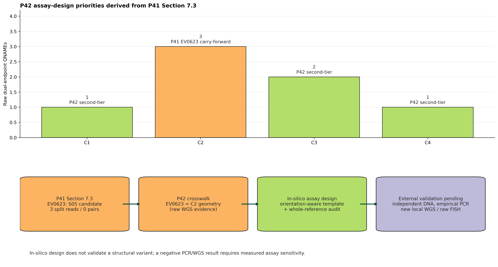

# P42 supplementary follow-up: P41 Section 7.3 candidate-event assay design

**Client/project:** Vedita-18 WGS advanced analysis (P42)  
**Date:** 2026-10-24  
**Species:** *Homo sapiens* (GRCh38)  
**Tissue/cell context:** DLD1 clone 4 ± doxycycline and P41 repeat-region follow-up; no additional biological material was analysed in this computational supplement.  
**Prepared by:** Zhen Gao, PhD, Principal Bioinformatics Scientist, Athenomics

## 1. Objective

This supplementary analysis is an incremental follow-up to Section 7.3 of the P41 Chr11 repeat-region WGS report. P41 identified EV0623, a low-support chr11–chr21 split-read candidate in DLD1 clone 4 + doxycycline. P42 reconciled that event with candidate C2 (one-base endpoint representation difference at each breakpoint end) but did not establish a high-confidence clone- or doxycycline-specific rearrangement. The present work converts the C2 geometry into an orientation-aware, reference-derived in-silico assay-design record and performs an in-silico specificity screen. It does not repeat the completed cohort-wide P42 analysis.

## 2. Inputs and data scope

The input evidence was restricted to the frozen P42 candidate ledger, normalized SV-event table, and the existing S05 aligned-read record used to audit raw support. The same GRCh38 reference assembly was used for virtual junction construction and primer-specificity assessment. No new FASTQ, BAM, PCR product, sequencing run, or raw FISH image was supplied.

## 3. Key findings

1. The P41 EV0623 geometry crosswalks to P42 candidate C2: chr11:114,607,191 / chr21:20,648,242 in normalized breakend notation. The one-base representation differences relative to P41 reflect breakpoint representation, not a second event.
2. In-silico C2 assay selection status: **no_in_silico_template_supported_by_raw_junction_sequence**. Selected pair: **none**. Selection note: No reference-derived template offset had an exact 24-mer spanning match in the recovered supporting read sequences.
3. The assay records are computational design evidence only. They do not establish that an amplicon exists in clone 4 + doxycycline genomic DNA, that C2 is clone-specific, or that C2 explains the P41 copy-number or cytogenetic observations.

## 4. Results overview

Figure 1 summarizes the evidence chain from the P41 EV0623 observation through the P42 C2 crosswalk, raw-alignment/template audit, in-silico assay screen, and the external observations still required for biological validation. The machine-readable candidate, raw-alignment, primer-specificity, and selection tables are supplied in `results/`.

## 5. Candidate-level result

The C2 virtual junction was constructed from the normalized reciprocal breakend orientation and a small coordinate-representation grid. The audit preserves original alignment attributes (QNAME, FLAG, coordinate, CIGAR, MAPQ, and SA tag where present) rather than treating supplementary alignments as independent molecules. C1, C3, and C4 were retained as contextual P42 candidates and were evaluated by the same design pipeline, but are not reclassified by this supplement.

## 6. Methods

For each candidate, a virtual breakpoint template was assembled from GRCh38 flanking sequences in the breakend-defined orientation. The C2 raw-support alignments were retrieved from the source BAM in local breakpoint windows and compared to junction-spanning template k-mers. Primer3-py generated short amplicon candidates around each virtual junction. Each individual primer was screened against a locally built GRCh38 BLAST database using `blastn-short`; only exact full-length single-locus primer matches at the expected locus were eligible for the in-silico selection status. This is a computational specificity screen, not laboratory validation.

## 7. Interpretation

The P41-to-P42 event reconciliation is technically coherent, and the supplied assay tables make the C2 hypothesis testable with independent material. However, low raw read support, repeat-context mapping ambiguity, and the absence of a high-depth sensitivity dataset mean that the result remains hypothesis-generating. No conclusion is made about causality for the P41 copy-number step or FISH-defined subpopulation.

## 8. Limitations and next work

No PCR, new sequencing, or raw FISH quantification was performed in this computational supplementary analysis. No independent breakpoint-spanning PCR result, new ≥60× local WGS data, or raw FISH image/scoring data was available. The required external inputs and their impact are listed in `results/external_input_status.tsv`.

The next evidence-bearing steps are: (1) test the selected C2 primer pair, if any, against independent DLD1 clone 4 ± doxycycline genomic DNA with suitable controls; (2) if sensitivity remains limiting, assess new local short-read WGS depth against the pre-specified ≥60× target; and (3) evaluate raw FISH images and per-cell scores before inferring a relationship to the cytogenetic observation. These steps require new experimental material or source data and were not performed here.

## 9. Deliverables

This incremental package contains one publication-style figure (PNG and PDF), candidate/template and raw-alignment audit tables, primer-specificity and assay-selection tables, a virtual-junction FASTA file, this report, and a machine-readable list of external inputs still required. It intentionally contains no duplicate P42 cohort-wide results and does not alter the P41 or 2026-10-23 P42 delivery directories.

---

Prepared for scientific review; not sent to the client.
