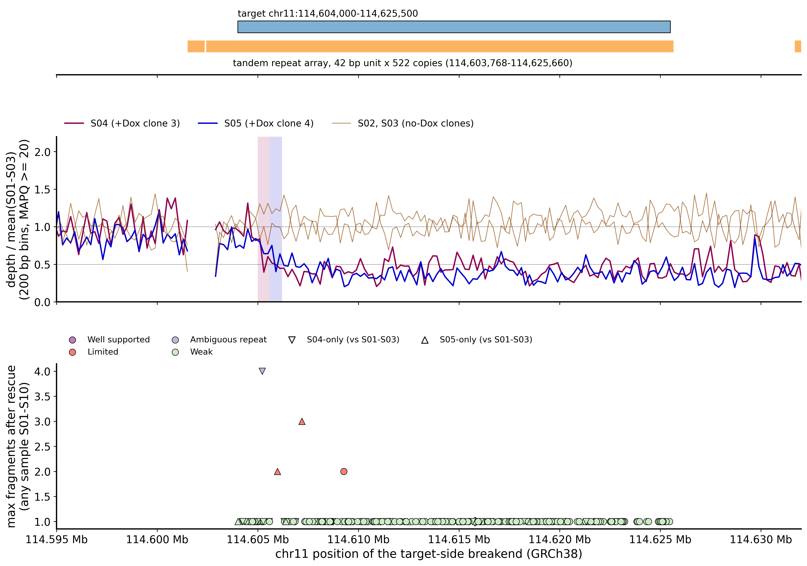
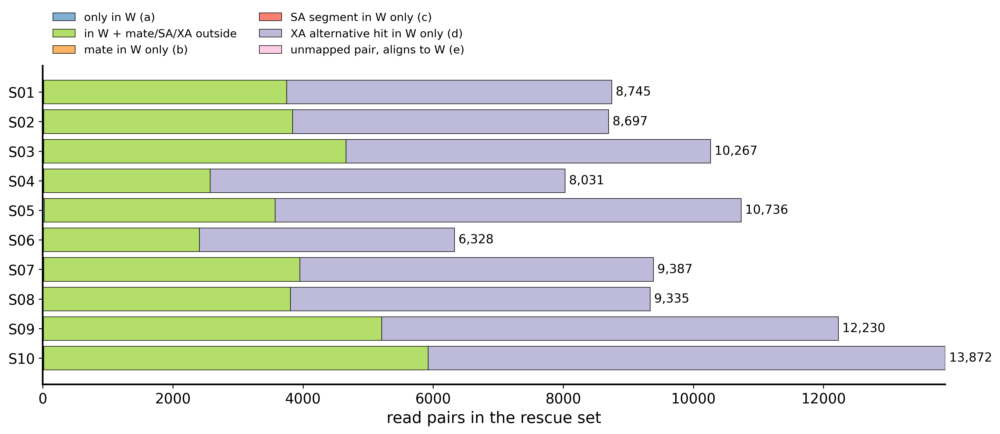
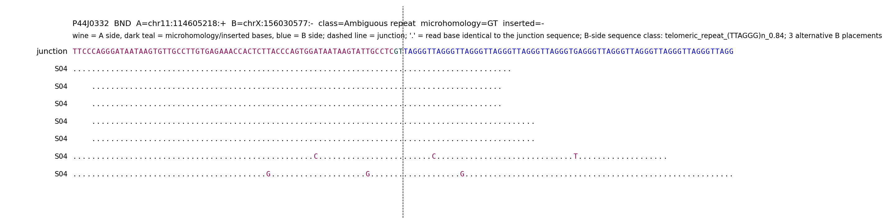
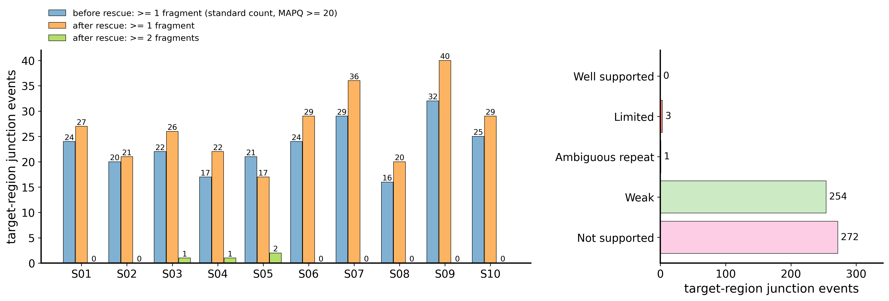
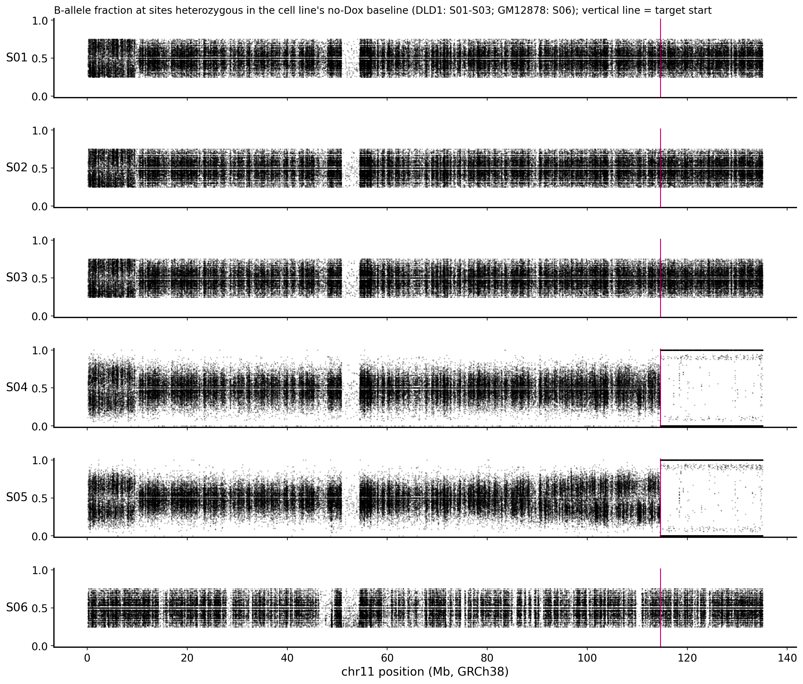

# Chr11 Locus Junction-Level Analysis with Read Rescue — Supplementary Report

**Report Date:** 2026-10-25
**Prepared by:** Zhen Gao, PhD, Principal Bioinformatics Scientist, Athenomics
**Prepared for:** Xin Lin and Vedita Anand Singh, Li lab, Boston Children's Hospital / Harvard Medical School
**Analysis Platform:** Linux HPC server
**Species:** Homo sapiens (reference genome hg38 / GRCh38, the same alignments as the 2026-10-09 report)
**Tissue / Cell type:** DLD1-136 and GM12878 cell lines (populations and clones), as named by the client; no further tissue annotation was supplied
**Target region:** chr11:114,604,000–114,625,500 (GRCh38)
**Samples reported:** S01–S10 (DLD1-136 n = 5, GM12878 n = 5); S11–S18 were used only as a background panel (Section 5)
**Relation to earlier work:** this report extends Section 7.3 of the report dated 2026-10-09 (`Chr11_Repeat_Region_WGS_SV_Report_1009.md`); that report is unchanged and its findings stand.

---

## 1. Objectives

Your request of 2026-10-13 asked for a junction-level analysis of the target region with read rescue — re-extracting every read that belongs to the locus, including reads with mapping quality (MAPQ) 0, multi-mapping reads, supplementary and secondary alignments, soft-clipped reads and unmapped reads whose mates map to the region — followed by local reassembly, and specifically:

1. base-pair breakpoints, including any microhomology or inserted sequence at each junction;
2. junction-spanning read counts per event, before and after read rescue;
3. which junctions are well supported and which are ambiguous because of repeat content;
4. which events are called by both structural-variant callers (Manta and DELLY) and which by only one.

All ten samples S01–S10 are included. To make the junction results interpretable, three parts of your second analysis (clone-specific event calling) that bear directly on the locus were added: the +doxycycline (+Dox) clone versus parental/control comparison for every locus junction with its criteria stated; the B-allele fraction (BAF) along chromosome 11; and a finer localisation of the depth step. No re-alignment of the sequencing run was performed; only the reads rescued for the locus were re-aligned (Section 6).

---

## 2. Core Conclusions

This section states, for each sample group, what the result means for you. Section 3 lists the measurements by topic; Section 8.1 adds the basis of each conclusion; Section 8.2 names the section and delivered file behind each point; Section 8.3 states what the data cannot show; Section 8.4 pairs each open question with an experiment.

| Sample group | Samples | Result | What it means |
| :--- | :---: | :---: | :---: |
| **DLD1 +Dox clone 3** | S04 | The broken end is now resolved at base-pair level: chr11 sequence ends at 114,605,216–114,605,218 and continues directly into the telomeric repeat (TTAGGG)n. The position coincides with the depth step. The distal chr11q copy that is lost is one complete homolog. | A terminal deletion of 11q whose broken end carries telomeric repeat — the pattern of a broken chromosome end capped by telomere sequence. |
| **DLD1 +Dox clone 4** | S05 | Two junctions at the step, both absent from S01–S03: a 376 bp fold-back inversion (chr11:114,605,973 joined head-to-head to 114,606,349) and a junction from chr11:114,607,192 to chr21:20,648,241. The same distal homolog is lost as in S04; the proximal side shows a graded allelic imbalance. | A more complex end than in S04; the combination is consistent with repeated breakage and rejoining at this site. |
| **DLD1 no-Dox population and controls** | S01–S03 | None of the three S04/S05 junctions is present (each with at least 11 reference fragments examined); S03 carries one 2-fragment local event of its own. | They remain a valid baseline: the S04/S05 junctions are specific to the +Dox clones. |
| **GM12878 population and clones** | S06–S10 | No junction at the locus has more than one supporting fragment in any sample. | No clone-specific rearrangement at the locus above the detection limit (Section 8.3). |
| **All 530 target-region junction candidates** | S01–S10 | After read rescue, 4 have two or more independent fragments; 254 rest on a single fragment; 272 are explained at least as well by an unrearranged copy of the repeat. | The locus is a 22 kb tandem repeat; most single-read junctions cannot be distinguished from repeat-copy misplacement. |

**Notes on the table**

1. **Row 1.** "Telomeric repeat" is a sequence description: the reads show only (TTAGGG)n beyond the junction, a sequence present at every chromosome end, so short reads cannot say whether new telomere was added at the break or the break joined an existing chromosome end (Section 8.3). The orientation of the repeat is the one found on a natural chromosome end.
2. **Row 2.** "Consistent with repeated breakage and rejoining" is our interpretation of three measurements together (a fold-back inversion at the step, the proximal gain and graded imbalance, the distal loss); it is not a measurement in itself.
3. **Rows 1–2.** Each event rests on 2–4 independent DNA fragments in one sample; their exact sequence is a strong basis for confirmation by polymerase chain reaction (PCR), which Section 8.4 proposes.

---

## 3. Key Findings

| # | Finding and measurements | Where |
| :--- | :--- | :---: |
| **1** | **The target region lies inside a 22 kb tandem repeat array.** | |
| 1a | chr11:114,603,768–114,625,660 is an array of a 42 bp unit (`GGTAACCACTGTTACCTGGTGGATAATAAGTATTGCCTCGTG`, about 522 copies), with an internal segmental duplication of 90.2% identity. | Section 7.1; Figure 1 |
| **2** | **Read rescue changed the junction evidence in both directions.** | |
| 2a | Per sample, 6,328–13,872 read pairs were rescued for the locus; 3,920–7,946 of them were placed elsewhere in the original alignments and list the locus only as an alternative hit. | Section 7.2; Figure 3 |
| 2b | The S04 telomere junction had 0 supporting fragments by the standard count and 4 after rescue. | Section 7.4 |
| 2c | 272 of 530 target-region candidates are better or equally explained by an unrearranged repeat copy once each read competes for its best placement. | Sections 7.3, 7.5 |
| **3** | **Three junctions are specific to the +Dox clones and coincide with the depth step.** | |
| 3a | S04: chr11:114,605,216–218 joined to (TTAGGG)n; 4 fragments (7 read ends); allele fraction 0.29 (95% confidence interval, CI, 0.12–0.55). | Section 7.4; Figure 5 |
| 3b | S05: fold-back inversion chr11:114,605,973 / 114,606,349, 2 fragments; chr11:114,607,192–chr21:20,648,241, 3 fragments. | Section 7.4; Figure 5 |
| 3c | Depth steps: S04 at 114,605,200 (95% CI 114,605,000–114,605,400); S05 at 114,605,800 (95% CI 114,605,600–114,606,000). | Section 7.6; Figure 1 |
| **4** | **Both +Dox clones lost the same chr11q homolog.** | |
| 4a | Distal chr11q (114.7–135.0 Mb): 97.8% (S04) and 98.0% (S05) of sites heterozygous in S01–S03 have become homozygous; at 99.78% of the 8,004 sites homozygous in both clones the same allele is retained. | Section 7.7; Figure 2 |
| **5** | **The two callers rarely agree with the read evidence at this locus.** | |
| 5a | Of 530 target-region junctions, 1 is called by DELLY only (the S05 chr21 junction, unfiltered output), 1 by Manta only (a single-fragment event), none by both. | Section 7.5 |
| **6** | **A widespread sequencing artefact explains a large class of earlier candidates.** | |
| 6a | Reads from short DNA fragments run into the adapter and a poly-G tail; the tail aligns to a poly-G tract at chr2:32,916,3xx. This accounts for the 693 earlier target-region candidates with a partner end there. | Section 7.3 |

---

## 4. Sample Information

Sample names, cell lines, doxycycline status and clone numbers are as supplied by the client. "Reads in the rescue set" counts read pairs (identified by their read name); Section 5 defines the sources.

| Sample | Cell line | Treatment | Role in this report | Autosomal depth (×, 2026-10-09 report) | Read pairs in the rescue set |
| :--- | :---: | :---: | :---: | :---: | :---: |
| S01 DLD1_pop | DLD1-136 | no Dox | DLD1 baseline (population) | 16.4 | 8,745 |
| S02 DLD1_c1_ctrl | DLD1-136 | no Dox | DLD1 baseline (control clone 1) | 14.4 | 8,697 |
| S03 DLD1_c2_ctrl | DLD1-136 | no Dox | DLD1 baseline (control clone 2) | 15.9 | 10,267 |
| S04 DLD1_c3_dox | DLD1-136 | +Dox | case (clone 3) | 16.4 | 8,031 |
| S05 DLD1_c4_dox | DLD1-136 | +Dox | case (clone 4) | 18.8 | 10,736 |
| S06 GM12878_pop | GM12878 | no Dox | GM12878 baseline (population) | 12.9 | 6,328 |
| S07 GM12878_c5 | GM12878 | no Dox | clone 5 | 15.9 | 9,387 |
| S08 GM12878_c6 | GM12878 | no Dox | clone 6 | 15.2 | 9,335 |
| S09 GM12878_c7 | GM12878 | no Dox | clone 7 | 18.8 | 12,230 |
| S10 GM12878_c8 | GM12878 | no Dox | clone 8 | 18.5 | 13,872 |

S11–S18 (Mutu I and DG75) were processed identically and used only to flag junctions that also occur in unrelated cell lines; they are not reported sample by sample.

---

## 5. Analysis Rationale and Decision Criteria

**What is examined.** All alignment records stored within the extraction window chr11:114,599,000–114,630,500 (target ± 5 kb, wider than the longest DNA fragment), plus every read pair that belongs to the locus but is stored elsewhere. A read pair enters the rescue set when (a) any of its records lies in the window, (b) its mate is placed in the window, (c) a supplementary alignment (the SA tag: another segment of the same read aligned elsewhere) lies in the window, (d) an alternative alignment listed by the aligner (the XA tag: an equally or nearly equally good placement) lies in the window, or (e) both mates are unmapped and one aligns to the window sequence. For every rescued pair, all of its records anywhere in the genome are retrieved. Nothing is selected from the earlier candidate list; earlier events are only compared afterwards.

**Counting units.** A *read end* is one sequenced read; a *fragment* is one read pair (one DNA molecule). Alternative alignments of the same read are kept as positional evidence but never counted as additional support. Reads marked as PCR or optical duplicates are kept in the files and excluded from counts. All thresholds below use fragments.

**Before and after rescue.** *Before* reproduces the earlier standard count: non-duplicate split reads whose two parts both have MAPQ ≥ 20, plus discordant pairs whose mates both have MAPQ ≥ 20. *After* re-tests every rescued read of every sample against a template of the junction sequence and against its best placement anywhere in the genome; a read end supports the junction only if it crosses the junction by at least 20 bases on each side and its alignment score (AS) on the junction template exceeds its best genome alignment by at least 10. A discordant pair supports it when its mates lie on the correct sides within the fragment-size limit (500 bp).

**Classification (fixed before the results were examined).**

| Class | Condition | Meaning |
| :--- | :---: | :--- |
| Well supported | ≥ 3 fragments in one sample; ≥ 2 kinds of evidence (split reads, discordant pairs, assembled contig); both 100 bp junction flanks placeable at a single genomic position (no other placement within 10 AS points); breakpoint uncertain by ≤ 10 bp | Ready for PCR confirmation |
| Limited | ≥ 2 fragments; flanks placeable at a single position; uncertainty ≤ 10 bp; but < 3 fragments or one kind of evidence | Real candidate with modest support |
| Ambiguous (repeat) | ≥ 2 fragments, but a flank, or the partner end, can be placed equally well at more than one position, or the breakpoint can shift by > 10 bp within identical sequence | Junction present, location of one end not unique |
| Weak | 1 fragment | Listed, not interpreted |
| Not supported | 0 fragments after rescue | Read evidence is explained at least as well without the junction |

**Clone comparison (part of your second request, applied at the locus).** In a sample, an event is *present* with ≥ 1 fragment (*confident* with ≥ 2); *absent* when no fragment supports it and ≥ 10 fragments span the same position without it (an allele at fraction 0.25 would be missed with probability ≤ 0.75^10 ≈ 6%); otherwise *underpowered*. An event is *+Dox-specific* when present in S04 or S05 and absent in all of S01–S03. No allele-fraction minimum is applied; the allele fraction and its 95% CI are reported per sample.

**Artefacts excluded (each counted in `tables/evidence_filter_impact.tsv`).** Soft clips and split alignments that consist of adapter read-through or follow it; segments with very low sequence complexity (base-composition entropy < 1.2 bits, e.g. poly-G tails); alternative alignments scoring more than 10 AS points below the read's best alignment.

---

## 6. Methods

**Input.** The coordinate-sorted, duplicate-marked Binary Alignment Map (BAM) files of the 2026-10-09 report (bwa-mem2 v2.2.1 `mem -Y`, GATK hg38 analysis set `Homo_sapiens_assembly38.fasta`), read only.

**Read rescue.** Each BAM was streamed once with samtools 1.23.1 (`view -e`) to collect records whose mate, SA segment or XA alternative hit falls in the window; window records were taken by region query; both-unmapped pairs were aligned to the window sequence with minimap2 2.30 (`-x sr`; kept when ≥ 40 aligned bases, ≥ 95% identity, entropy ≥ 1.6 bits). All records of every rescued read name were then fetched by position. Every alignment record in the window has full read sequence (no hard clipping; verified for all 18 samples).

**Local re-alignment of rescued reads.** The full sequences of rescued reads were re-aligned to the same reference with bwa-mem2 v2.2.1 `mem -a -Y`, which writes every alternative placement as an explicit secondary alignment. This re-aligns the rescue set only, not the sequencing run.

**Junction discovery.** Split reads, soft clips ≥ 20 bp and discordant pairs (both views: original and re-aligned) with at least one end in the window were clustered across all samples with a 15 bp tolerance. Clusters with ≥ 2 fragments were assembled locally with SPAdes v4.3.0 (`--sc --only-assembler`, k = 21, 33, 55; reads trimmed at the adapter) per sample and per cell line; contigs and soft-clip consensus sequences were aligned with bwa-mem2 `mem -a`.

**Genotyping.** For each junction a 400 + 400 bp junction template and two 801 bp reference templates were built; all rescued reads of all samples were aligned to them (bwa-mem2 `mem -a -Y`) and scored as in Section 5. Junctions whose support comes from the same reads and differ only in the placement of the partner end were merged into one event, listing the alternative placements.

**Breakpoint annotation.** Microhomology and breakpoint uncertainty were computed from the reference by sliding the junction while the junction sequence stays identical; inserted sequence comes from the reads or contigs. Each 100 bp flank was aligned to GRCh38 with `mem -a` to count equally good placements. Repeat annotation: UCSC hg38 RepeatMasker, simpleRepeat and genomicSuperDups tables.

**Caller concordance.** Manta 1.6.0 (per sample genome-wide `diploidSV` and `candidateSV`; joint target-window run) and DELLY v2.3.0 (per sample discovery; window re-genotyping) outputs of the 2026-10-09 run were compared with every junction: both ends within 100 bp (as in the earlier report) and the same orientation.

**Depth step and BAF.** Depth per base (samtools `depth`, MAPQ ≥ 20 and ≥ 0, duplicates excluded) in 200 bp bins, normalised to each sample's own median over chr11:114.40–114.58 Mb and divided by the mean of S01–S03; a two-level step model with 1,000 block bootstraps gave the boundary and its 95% CI. Single-nucleotide variants (SNVs) on chr11 were called jointly in S01–S10 with bcftools 1.23.1 (`mpileup -q 20 -Q 20`, `call -mv`, variant quality score QUAL ≥ 30); BAF = alternative-allele reads / all reads at sites heterozygous in every baseline sample of the cell line (allele fraction 0.25–0.75, depth ≥ 10).

---

## 7. Results

### 7.1 The target region is a tandem repeat array

The simpleRepeat annotation places a 42 bp unit repeated about 522 times across chr11:114,603,768–114,625,660, which covers the whole target region (Figure 1, top). Adjacent copies differ by a few bases, so a 150 bp read usually still has a best position, but often only a few alignment-score points ahead of the next copy. This is why the earlier report flagged many events as repeat-ambiguous, and why junction support has to be judged by competition between placements rather than by mapping quality alone.

*Figure 1. Top: target region and the tandem repeat array. Middle: depth of S04 and S05 (and of the no-Dox clones S02, S03) relative to the mean of S01–S03, 200 bp bins, MAPQ ≥ 20; shaded bands are the 95% CIs of the depth step; the gap at 114.6015–114.603 Mb has no MAPQ ≥ 20 reads in any sample. Bottom: every target-region junction with at least one supporting fragment, at the position of its target-side end; colour = class, marker shape = +Dox-specific events.*

### 7.2 Read rescue

| Sample | Records stored in the window | Read pairs rescued | Of which listed only through an alternative (XA) hit |
| :--- | :---: | :---: | :---: |
| S01 | 7,468 | 8,745 | 4,994 |
| S02 | 7,650 | 8,697 | 4,857 |
| S03 | 9,302 | 10,267 | 5,607 |
| S04 | 5,111 | 8,031 | 5,458 |
| S05 | 7,113 | 10,736 | 7,164 |
| S06 | 4,776 | 6,328 | 3,920 |
| S07 | 7,857 | 9,387 | 5,435 |
| S08 | 7,577 | 9,335 | 5,528 |
| S09 | 10,390 | 12,230 | 7,020 |
| S10 | 11,816 | 13,872 | 7,946 |

More than half of each rescue set consists of reads placed elsewhere whose alternative placement lies in the repeat array — the multi-mapping reads you asked us to include. None of the 0.25–3.3 million both-unmapped reads per sample aligned to the window sequence. No record in the window of any of the 18 samples is hard-clipped or an explicit secondary alignment, so every record carries its full read sequence (Figure 3).

*Figure 3. Read pairs in each sample's rescue set, by the route through which they entered (Section 5).*

### 7.3 An adapter and poly-G artefact

The libraries have a median fragment length of about 160 bp, so many 150 bp reads run through the end of the DNA fragment into the sequencing adapter (`AGATCGGAAGAGCACACGTCTGAACTCCAGTCAC…`) and then into a run of G bases, the signal produced by this chemistry when no template is left. Aligners place that poly-G tail on a 150 bp poly-G tract at chr2:32,916,330–32,916,480 and report the read as split. Across the 18 samples, 4,768 such split alignments, 55,485 adapter soft clips and 149 poly-G discordant pairs were removed (`tables/evidence_filter_impact.tsv`). Of the 1,181 target-region events listed in the earlier report, 693 have a partner end in this tract; the earlier report had already treated it as a mapping artefact, and this analysis identifies the sequence that produces it.

### 7.4 Junctions with two or more fragments

| Event | Junction (GRCh38) | Microhomology / inserted | Class | Present in | Fragments before → after rescue | Allele fraction (95% CI) | S01–S03 | Callers |
| :--- | :---: | :---: | :---: | :---: | :---: | :---: | :---: | :---: |
| P44J0332 | chr11:114,605,216–218 (+) → (TTAGGG)n | `GT` / none | Ambiguous (partner end) | S04 | 0 → 4 | 0.29 (0.12–0.55) | absent (13, 12, 24 reference fragments) | neither |
| P44J0115 | chr11:114,605,971–973 (+) ↔ chr11:114,606,347–349 (+), 376 bp fold-back inversion | `TA` / none | Limited | S05 | 1 → 2 | 0.17 (0.05–0.45) | absent (15, 11, 28) | neither |
| P44J0289 | chr11:114,607,190–192 (+) → chr21:20,648,241 (−) | `AT` / none | Limited | S05 | 3 → 3 | 0.27 (0.10–0.57) | absent (18, 14, 18) | DELLY (unfiltered only) |
| P44J0389 | chr11:114,609,273–279 (−) ↔ 114,609,283 (−), 10 bp inversion | `GTTACC` / none | Limited | S03 | 1 → 2 | 0.09 (0.02–0.27) | S03 only | neither |

Positions are given as the range within which the junction can slide over identical sequence (the microhomology). "(+)" means the chr11 sequence to the left of the position is retained; "(−)" the sequence to the right.

**S04 (P44J0332).** Seven read ends from four DNA fragments read chr11 sequence up to 114,605,216–218 and then only TTAGGG repeats, up to the end of the read or of the DNA fragment (Figure 5, `figures/junction_views/P44_Fig5_P44J0332.png`). The repeat matches telomeric-repeat tracts at the ends of chrX, chr2 and chr4 and an interstitial tract on chr10 equally well, so the partner end has no unique genomic position; the chr11 end is unique (one placement for its 100 bp flank). None of the four fragments was counted by the standard method, because the telomeric part of the reads was soft-clipped or aligned elsewhere with MAPQ 0; the junction was found only through the rescued alignments. The junction lies inside the 95% CI of the S04 depth step (Section 7.6). Its allele fraction is compatible with one of two chr11 copies.

**S05 (P44J0115, P44J0289).** The fold-back inversion joins the plus strand at 114,605,973 to the minus strand at 114,606,349 (both "+" ends), i.e. the sequence folds back on itself 376 bp further along; it lies inside the 95% CI of the S05 depth step. The chr21 junction (the earlier report's EV0623, refined to the same coordinates and `AT` microhomology) lies 1.2 kb distal of it; its chr21 end is uniquely placeable. The chr21 junction is underpowered in S04 (7 reference fragments) because S04 has lost that segment of one copy.

**S03 (P44J0389).** A 10 bp inversion inside the repeat array with 2 fragments in the no-Dox control clone S03 only; it is not related to the +Dox phenotype.

*Figure 5 (one of four; all in `figures/junction_views/`). Junction sequence (wine: chr11 side, dark teal: microhomology, blue: partner side) and every read end that supports it; "." marks a base identical to the junction sequence.*

### 7.5 All target-region junctions, before and after rescue, and caller concordance

530 distinct junctions have at least one end in the target region (250 more lie only in the ± 5 kb flanks; `tables/junction_table_window_context.tsv`). Their classes: Well supported 0, Limited 3, Ambiguous (repeat) 1, Weak 254, Not supported 272. Of the 272 not supported, 6 had at least one fragment by the standard count; the others arose from single reads, contigs or soft-clip consensus sequences that, once each read competes for its best placement, are explained at least as well by an unrearranged repeat copy.

| Sample | Events with ≥ 1 fragment before rescue | after rescue | after rescue, ≥ 2 fragments |
| :--- | :---: | :---: | :---: |
| S01 | 24 | 27 | 0 |
| S02 | 20 | 21 | 0 |
| S03 | 22 | 26 | 1 |
| S04 | 17 | 22 | 1 |
| S05 | 21 | 17 | 2 |
| S06 | 24 | 29 | 0 |
| S07 | 29 | 36 | 0 |
| S08 | 16 | 20 | 0 |
| S09 | 32 | 40 | 0 |
| S10 | 25 | 29 | 0 |

The earlier report's candidates with at least one MAPQ ≥ 20 split read in S01–S10 (179 events; the basis of the per-sample numbers in our 2026-10-14 message) resolve as follows: 175 Weak, 1 Limited (EV0623 = P44J0289), 2 Not supported, 1 without a counterpart in the rescued evidence. Caller concordance for all 530 target-region junctions: 1 called by DELLY only (P44J0289, per-sample unfiltered discovery output of S05), 1 by Manta only (P44J0506, a single-fragment event), 0 by both. 12 of the 258 events with at least one fragment in S01–S10 also have a fragment in a Mutu I or DG75 sample; none of the four events in Section 7.4 does.

*Figure 4. Left: target-region junctions with support in each sample before and after rescue. Right: classes of the 530 target-region junctions.*

### 7.6 The depth step at base-pair scale

| Sample | Step position (start of 200 bp bin) | 95% CI | Depth ratio left / right of the step |
| :--- | :---: | :---: | :---: |
| S04 | 114,605,200 | 114,605,000–114,605,400 | 0.98 / 0.43 |
| S05 | 114,605,800 | 114,605,600–114,606,000 | 0.83 / 0.37 |

The ratios are relative to the S01–S03 mean after normalisation to each sample's own proximal flank (chr11:114.40–114.58 Mb), so they describe the step itself; S01–S03 and GM12878 show no step at these positions. The S04 telomere junction (114,605,216–218) and the S05 fold-back inversion (114,605,971–973) each lie in their own sample's interval; the two steps are about 600 bp apart and their CIs are adjacent without overlapping.

### 7.7 chr11 B-allele fraction

| Segment | Sites | S01–S03: fraction homozygous | S04 | S05 | S04 median abs(BAF − 0.5) | S05 median abs(BAF − 0.5) |
| :--- | :---: | :---: | :---: | :---: | :---: | :---: |
| chr11p 0–50 Mb | 34,495 | 0.000 | 0.005 | 0.002 | 0.100 | 0.093 |
| proximal 99.0–114.5 Mb | 11,363 | 0.000 | 0.004 | 0.003 | 0.100 | 0.159 |
| distal 114.7–135.0 Mb | 16,650 | 0.000 | 0.978 | 0.980 | 0.500 | 0.500 |

"Fraction homozygous" counts sites heterozygous in all of S01–S03 at which the clone shows BAF < 0.1 or > 0.9. Distal of the step both clones retain a single chr11q homolog — the same one in both (8,004 sites homozygous in both clones; the same allele retained at 99.78%). In S05 the proximal imbalance increases toward the step (Figure 2), together with the 1.48× proximal depth reported earlier. GM12878 (S06–S10) shows no homozygous segment on chr11 (all fractions ≤ 0.007).

*Figure 2. BAF at sites heterozygous in the cell line's no-Dox baseline (DLD1: all of S01–S03; GM12878: S06); because sites are selected for allele fraction 0.25–0.75 in the baseline, baseline panels are bounded by that range. Vertical line: start of the target region.*

### 7.8 Clone-specific events at the locus

DLD1: 39 target-region junctions are present in S04 or S05 and in none of S01–S03 (22 in S04, 17 in S05); 3 of them have ≥ 2 fragments (the three in Section 7.4) and 36 have 1 fragment; 10 of the 39 have at least one underpowered baseline sample. No junction is present in both +Dox clones. GM12878: 122 junctions are present in one clone and absent from S06 (S07 36, S08 20, S09 40, S10 29); each has a single fragment. Per-sample labels are in `tables/junction_table_target.tsv` (columns `DLD1_dox_comparison`, `GM12878_clone_specific`, `S0n_state`).

---

## 8. Conclusions, Limitations and Next Steps

### 8.1 Conclusions by sample group

| Sample group | Conclusion | Basis |
| :--- | :--- | :---: |
| S04 (+Dox clone 3) | Terminal loss of one chr11q homolog from 114,605,216–218, with telomeric repeat joined to the retained chr11 end | 4 fragments, 7 read ends crossing the junction; junction inside the depth-step CI; distal loss of heterozygosity at 97.8% of sites (Sections 7.4, 7.6, 7.7) |
| S05 (+Dox clone 4) | Loss of the same homolog distal of 114.606 Mb; a fold-back inversion at the step and a chr21 junction 1.2 kb distal; proximal gain with graded imbalance | 2 + 3 fragments; fold-back inside the depth-step CI; distal loss of heterozygosity 98.0%; proximal BAF imbalance 0.159 (Sections 7.4, 7.6, 7.7) |
| S01–S03 | Baseline for the +Dox clones; carries none of the three +Dox junctions | ≥ 11 reference fragments per sample at each junction, 0 supporting (Section 7.4) |
| S06–S10 | No junction above one fragment at the locus | Section 7.5 |
| Locus overall | Most single-read junctions in this 22 kb repeat cannot be distinguished from repeat-copy misplacement; 272 of 530 are not supported once reads compete for placement | Sections 7.1, 7.5 |

### 8.2 Practical reading

1. **S04: the broken end is resolved — chr11 at 114,605,216–218 joined to telomeric repeat.** Evidence: Section 7.4, `tables/junction_table_target.tsv` (row P44J0332), `figures/junction_views/P44_Fig5_P44J0332.png`, `locus_BAM/S04_DLD1_c3_dox.locus_rescue.bam`.
2. **S05: a different and more complex end on the same homolog — a fold-back inversion at the step and a chr21 junction.** Evidence: Sections 7.4 and 7.7, rows P44J0115 and P44J0289, `figures/junction_views/P44_Fig5_P44J0115.png` and `P44_Fig5_P44J0289.png`, `supporting_analyses/chr11_BAF/retained_homolog_S04_vs_S05.tsv`.
3. **S01–S03 remain a valid baseline.** Evidence: Section 7.4 table (reference fragment counts), `tables/junction_by_sample_long.tsv`.
4. **GM12878 clones: no clone-specific rearrangement at the locus above one fragment.** Evidence: Sections 7.5 and 7.8, `tables/junction_table_target.tsv` column `GM12878_clone_specific`.
5. **Most junction candidates at this locus are single reads inside a 22 kb repeat and should not be followed up individually.** Evidence: Sections 7.1 and 7.5, Figure 4, `tables/junction_table_target.tsv` column `classification`.

### 8.3 Limitations

* **Partner of the S04 junction.** The reads contain only (TTAGGG)n beyond the junction. They cannot distinguish new telomere added at the break from a join to the telomere of another chromosome end. In every supporting read the sequence beyond the junction is telomeric repeat up to the end of the read or of the DNA fragment.
* **Support level.** The three +Dox junctions rest on 2–4 independent fragments each in one sample (about 10–15 fragments cover each position). They were not seen at the "Well supported" level, and re-aligning the same sequencing data, however carefully, is not an independent biological test; PCR across each junction is the direct confirmation (Section 8.4).
* **Detection limit.** With 10–28 fragments spanning a position, a junction carried by a fraction 0.25 of the spanning DNA fragments yields ≥ 3 supporting fragments with probability about 0.5–0.97, and one at 0.10 with probability about 0.1–0.5 (per-sample values: `tables/junction_by_sample_long.tsv`). Junctions in a minority of cells may be missed; "absent" means "not found above roughly this level".
* **Repeat array.** Within the 42 bp-unit array, a rearrangement that joins two near-identical copies (an expansion or contraction of the array) produces a sequence identical to the reference and cannot be seen at the junction level; such events would show only as a depth change.
* **Window.** Junctions are examined when at least one end lies within the target ± 5 kb; events farther away are outside this analysis.
* **Clone comparison.** The +Dox clones are n = 2, and there is no doxycycline-only control without induction of Epstein–Barr virus nuclear antigen 1 (EBNA1) (as stated in the earlier report).
* **Genome-wide data.** This report covers the locus. The genome-wide Manta and DELLY files are delivered as produced on 2026-10-09; genome-wide single-nucleotide variant and small insertion/deletion calls were made for chr11 only, for the BAF analysis.

### 8.4 Suggested confirmation and next steps

| Open question | Suggested experiment |
| :--- | :--- |
| Is the S04 junction real, and is it a telomere added at the break? | PCR with a chr11 primer proximal of 114,605,216 and a telomere-repeat primer (single-telomere-length-type assay) on S04, S01–S03 and S05 DNA; fluorescence in situ hybridisation (FISH) with a probe proximal of 114.6 Mb and a telomere probe |
| Are the S05 fold-back inversion and chr21 junction real? | Junction-spanning PCR on S05 and S01–S04 DNA; primers can be designed from `sequences/junction_and_reference_templates.fa` |
| Does S05 show further fold-back or rejoining products along proximal 11q? | Copy-number analysis of 11q at higher resolution (for example droplet digital PCR at several proximal positions); deeper short-read sequencing of S05 would raise junction detection along the proximal gain |
| Is the same chr11q homolog targeted in further +Dox clones? | BAF and loss-of-heterozygosity analysis of additional independent +Dox clones (existing pipeline; no new method needed) |

---

## 9. Deliverable Files

All paths are relative to this delivery folder. This report is the entry point.

| File or folder | Content |
| :--- | :--- |
| `Chr11_Locus_Junction_Read_Rescue_Report_<MMDD>.md` | This report |
| `tables/junction_table_target.tsv` | One row per junction with an end in the target region: breakpoints and uncertainty intervals, type, microhomology and inserted sequence, class and ambiguity reason, alternative partner placements, flank uniqueness, repeat annotation, Manta/DELLY columns, earlier event ID, and per sample S01–S10 the before/after fragment counts, reference fragments, allele fraction with 95% CI and present/absent/underpowered state |
| `tables/junction_table_window_context.tsv` | Same columns for junctions with ends only in the ± 5 kb flanks |
| `tables/junction_by_sample_long.tsv` | Every junction × all 18 samples (S11–S18 marked as background panel): counts, allele fraction, detection probabilities |
| `tables/caller_concordance_by_sample.tsv` | Every junction × sample × Manta/DELLY call set: match class and record IDs |
| `tables/rescue_source_summary.tsv` | Rescued read pairs per sample by source; completeness |
| `tables/evidence_filter_impact.tsv` | Count of every evidence item removed and the reason |
| `figures/` | Figures 1–4 (`P44_Fig1_locus_overview`, `P44_Fig2_chr11_BAF`, `P44_Fig3_rescue_sources`, `P44_Fig4_before_after_and_classes`; PNG and PDF) |
| `figures/junction_views/` | Figure 5: one base-level view per junction with ≥ 2 fragments (4 junctions; PNG and PDF) |
| `locus_BAM/` | For S01–S10: every alignment record of every rescued read pair (`<sample>.locus_rescue.bam` and index), viewable in the Integrative Genomics Viewer (IGV); tag `ZR` gives the rescue source |
| `sequences/junction_and_reference_templates.fa` | Junction and reference sequences (400 bp each side) for every junction; basis for primer design |
| `sequences/local_assembly_contigs.fa` | All locally assembled contigs |
| `supporting_analyses/depth_boundary/` | `depth_bins_200bp.tsv`, `boundary_estimates.tsv` |
| `supporting_analyses/chr11_BAF/` | `baf_segments.tsv`, `retained_homolog_S04_vs_S05.tsv`, `baf_sites.tsv.gz` |
| `supporting_analyses/chr11_SNV/` | `chr11_S01_S10.QUAL30.vcf.gz` (joint chr11 calls, S01–S10) and index |
| `genome_wide_SV_VCF/` | Per sample S01–S10: Manta `diploidSV` unfiltered and PASS, Manta `candidateSV`, DELLY unfiltered and PASS (Variant Call Format, VCF, with index); `vcf_inventory.tsv`, `md5sums.txt` |
| `md5sums_delivery.txt` | Checksums of every file in this folder |

---

**Zhen Gao, PhD**
Principal Bioinformatics Scientist, Athenomics
