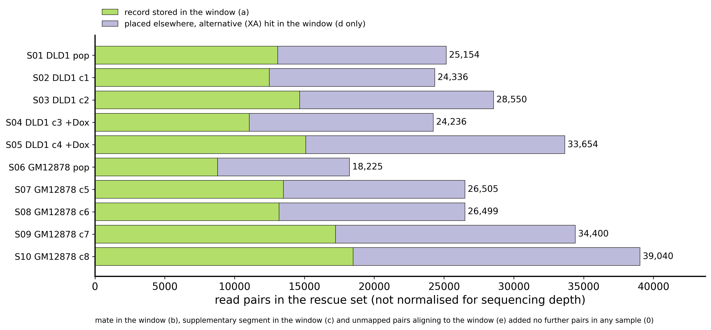
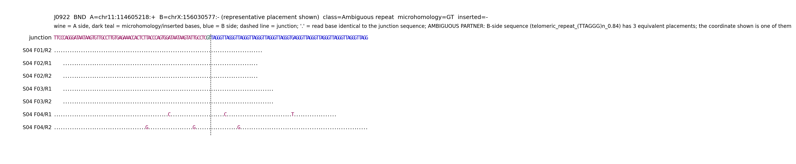
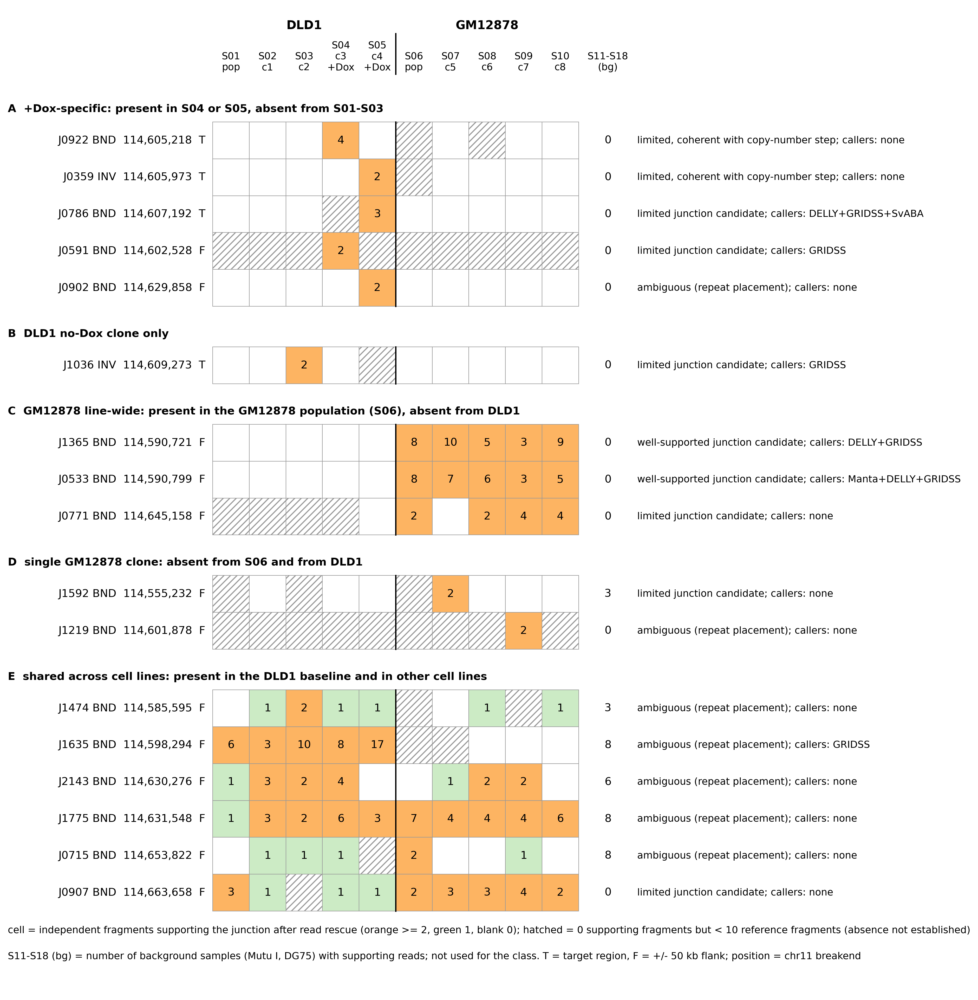
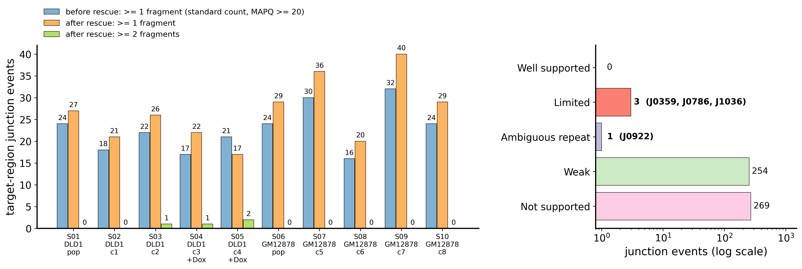
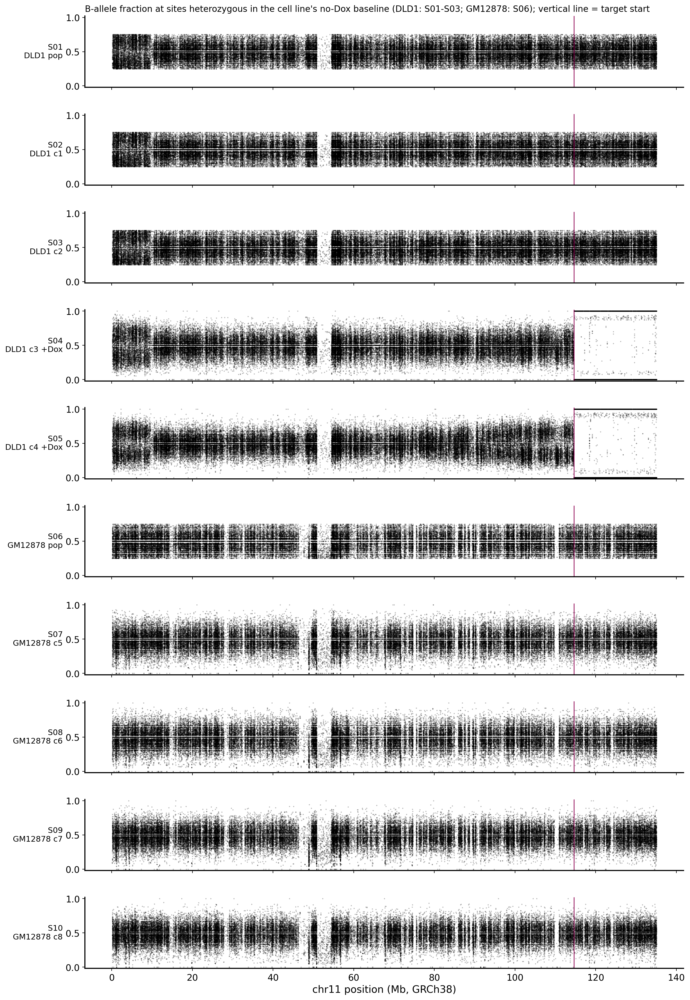

# Chr11 位点 junction 层面分析（含 read rescue）与 DLD1 克隆比较 —— 中文版

> **内部中文阅读版，不进客户交付，未发送。** 英文原件（唯一的交付版本）：`../custom_research_report_20261025/Chr11_Locus_and_DLD1_Clone_Analysis_Report_1025.md`，本文由该文件逐节翻译（2026-10-25）。英文原件若再修改，以英文原件为准，本文需同步。
> 文中反引号内的文件路径均**相对于交付目录** `custom_research_report_20261025/`；图片链接已改为指向该目录。

**Report Date（报告日期）:** 2026-10-25
**Prepared by（编写人）:** Zhen Gao, PhD, Principal Bioinformatics Scientist, Athenomics
**Prepared for（客户）:** Xin Lin and Vedita Anand Singh, Li lab, Boston Children's Hospital / Harvard Medical School
**Analysis Platform（分析平台）:** Linux HPC server
**Species（物种）:** Homo sapiens（参考基因组 hg38 / GRCh38，与 2026-10-09 报告使用同一套比对结果）
**Tissue / Cell type（组织／细胞）:** DLD1-136 与 GM12878 细胞系（群体与克隆），名称按客户提供；客户未提供其他组织注释
**Target region（目标区）:** chr11:114,604,000–114,625,500（GRCh38），在分析窗口 chr11:114,554,000–114,675,500（目标区 ± 50 kb，与前一份报告相同）内分析
**Samples reported（报告样本）:** S01–S10（DLD1-136 n = 5，GM12878 n = 5）；S11–S18 只作 background panel（第 5 节）
**与此前工作的关系:** 本报告是对 2026-10-09 报告（`Chr11_Repeat_Region_WGS_SV_Report_1009.md`）第 7.3 节的延伸；该报告不作改动，其结论成立。

---

## 1. 目标（Objectives）

客户 2026-10-13 的请求，要求在现有 hg38 比对结果上做两项分析。

**Analysis 1 —— 目标区的 junction 层面分析，含 read rescue：** 重新提取属于该位点的全部 read，包括 mapping quality（MAPQ）为 0 的 read、multi-mapping read、supplementary 与 secondary alignment、soft-clipped read，以及 mate 比对到该区域的 unmapped read；做局部重组装；并报告：

1. bp 分辨率的断点，包括每个 junction 处的 microhomology 或 inserted sequence；
2. 每个事件在 read rescue 前后的 junction-spanning read 计数；
3. 哪些 junction 有充分支持（well supported），哪些因 repeat 序列而定位不明（ambiguous）；
4. 哪些事件被两个结构变异（structural variant，SV）caller —— Manta 与 DELLY —— 同时调出，哪些只被其中一个调出。

**Analysis 2 —— 克隆特异事件识别：** 找出在 +doxycycline（+Dox）DLD1 克隆 S04、S05 中存在，而在亲本群体 S01 以及对照克隆 S02、S03 中不存在的事件，并写明所用的过滤判据。

**Deliverables（交付文件）:** Manta 与 DELLY 的 SV VCF（Variant Call Format）文件，unfiltered 与 filtered 两版；single-nucleotide variant（SNV）与 small insertion/deletion（indel）的 VCF 文件；以及带有 caller 支持列的、已注释的逐事件表。

以上全部在本报告中回答。Analysis 2 以两种分辨率各报告一次：一是在目标位点上，基于 read rescue 证据（第 7.8 节）；二是在全基因组范围，基于 caller 输出（第 7.9 节）。在位点上，Manta/DELLY 的比较中另外加入了两个 SV caller：GRIDSS 与 SvABA；并为验证设计了跨 junction 的引物。`tables/client_request_coverage.tsv` 逐条列出客户请求中的每个问题和每项交付物，以及回答它的章节和文件。

---

## 2. 核心结论（Core Conclusions）

本节按样本组说明结果对客户意味着什么。第 3 节按主题列出测量结果；第 8.1 节补充每条结论的依据；第 8.2 节列出每条结论背后的章节与交付文件；第 8.3 节说明数据不能说明什么；第 8.4 节为每个未决问题配一个实验。

| 样本组 | 样本 | 结果 | 意味着什么 |
| :--- | :---: | :---: | :---: |
| **DLD1 +Dox 克隆 3** | S04 | 断端已解析到 bp 水平：chr11 序列终止于 114,605,216–114,605,218，紧接着直接进入端粒重复（TTAGGG）n。该位置位于深度断崖之内；远端丢失的 chr11q 拷贝是一条完整的同源染色体（homolog）。 | 11q 末端缺失，其断端带有端粒重复 —— 即染色体断端被端粒序列封顶的模式。已提供 junction-specific 的 PCR 引物对。 |
| **DLD1 +Dox 克隆 4** | S05 | 断崖附近有两个 junction，S01–S03 中均不存在：一个位于深度断崖内的 376 bp fold-back inversion（chr11:114,605,973 与 114,606,349 头对头相连），以及一个 chr11:114,607,192 到 chr21:20,648,241 的 junction，位于断崖远端 1.2 kb。丢失的远端 homolog 与 S04 相同；近端呈渐变的等位基因失衡。 | 断端比 S04 更复杂；这些特征的组合符合在该位点发生反复断裂与重连。chr21 junction 是四个 caller 中有三个调出的那个事件。 |
| **DLD1 无 Dox 群体与对照** | S01–S03 | S04/S05 的三个 junction 一个也不存在（每个 junction 至少检查了 11 个 reference fragment）；S03 自身带有一个 2-fragment 的局部事件。 | 它们仍是有效的基线：S04/S05 的 junction 为 +Dox 克隆所特有。 |
| **GM12878 群体与克隆** | S06–S10 | 位点上没有超过一个 fragment 的克隆特异 junction。五个 GM12878 样本共有两个 well-supported junction，位于目标区近端 13 kb（chr11:114,590,721 与 114,590,799），所有 DLD1 样本中均不存在。 | 位点上没有超过检出下限的克隆特异重排；这对共有 junction 是 GM12878 细胞系本身的特征，不属于任何一个克隆。 |
| **目标区全部 527 个 junction 候选** | S01–S10 | read rescue 后，4 个有两个或以上独立 fragment；254 个只有一个 fragment；269 个用未重排的 repeat 拷贝至少同样能解释。 | 该位点是一段 22 kb 的 tandem repeat；大多数单 read 的 junction 无法与 repeat 拷贝的错误定位区分。 |
| **DLD1，全基因组** | S01–S05 | 基因组其他位置有 13 个结构变异在 S04 或 S05 中存在、在 S01–S03 中均不存在（S04 8 个，S05 5 个）；没有一个在两个 +Dox 克隆中都存在，也没有一个位于 chr11。13 个中有 7 个也被 Manta 调出。 | 位点之外的克隆特异候选事件，各自只属于一个克隆；没有任何一个提示两个 +Dox 克隆共有第二处重排。 |

**表注**

1. **第 1 行。** “端粒重复”是对序列的描述：junction 之后的 read 只显示（TTAGGG）n，这种序列在每条染色体末端都有，因此 short read 无法判断是在断点处新加了端粒，还是断端连接到了某个已有的染色体末端（第 8.3 节）。该重复的方向与天然染色体末端的方向一致。
2. **第 2 行。** “符合反复断裂与重连”是我们对三项测量结果合并后的解读（断崖处的 fold-back inversion、近端的拷贝增加与渐变失衡、远端的丢失），本身不是一项测量。
3. **第 1–2 行。** 每个事件都只依靠单个样本中的 2–4 个独立 DNA fragment。本报告中任何 junction 达到的最高 claim level 是“limited，与拷贝数断崖一致”（第 5 节）：序列证据是精确的，但尚未做任何独立检测。跨每个 junction 的 PCR 是直接的验证方式（第 8.4 节）。

---

## 3. 关键发现（Key Findings）

| # | 发现与测量值 | 出处 |
| :--- | :--- | :---: |
| **1** | **目标区位于一段 22 kb 的 tandem repeat array 内。** | |
| 1a | chr11:114,603,768–114,625,660 是一个 42 bp 重复单元组成的 array（`GGTAACCACTGTTACCTGGTGGATAATAAGTATTGCCTCGTG`，约 522 个拷贝），内部含一段 identity 90.2% 的 segmental duplication。 | 第 7.1 节；图 1 |
| **2** | **read rescue 使 junction 证据向两个方向改变。** | |
| 2a | 每个样本为窗口 rescue 了 18,225–39,040 个 read pair；其中 9,440–20,554 个在原始比对中被放在别处，只在 alternative hit 中列出该窗口。 | 第 7.2 节；图 3 |
| 2b | S04 的端粒 junction 按标准计数有 0 个支持 fragment，rescue 后为 4 个。 | 第 7.4 节 |
| 2c | 当每条 read 竞争其最佳定位后，527 个目标区候选中有 269 个用未重排的 repeat 拷贝能解释得更好或同样好。 | 第 7.3、7.5 节 |
| **3** | **三个 junction 为 +Dox 克隆所特有；其中两个位于深度断崖之内。** | |
| 3a | S04：chr11:114,605,216–218 连接（TTAGGG）n；4 个 fragment（7 个 read end）；allele fraction 0.29（95% confidence interval，CI，0.12–0.55）。 | 第 7.4 节；图 5 |
| 3b | S05：fold-back inversion chr11:114,605,973 / 114,606,349，2 个 fragment；chr11:114,607,192–chr21:20,648,241，3 个 fragment。 | 第 7.4 节；图 5 |
| 3c | 深度断崖：S04 位于 114,605,200（95% CI 114,605,000–114,605,400）；S05 位于 114,605,800（95% CI 114,605,600–114,606,000）。 | 第 7.6 节；图 1 |
| **4** | **两个 +Dox 克隆丢失的是同一条 chr11q homolog。** | |
| 4a | 远端 chr11q（114.7–135.0 Mb）：在 S01–S03 中杂合的位点，S04 有 97.8%、S05 有 98.0% 变为纯合；在两个克隆中都纯合的 8,004 个位点上，99.78% 保留的是同一个等位基因。 | 第 7.7 节；图 2 |
| **5** | **在该位点，caller 与 read 证据很少一致。** | |
| 5a | 527 个目标区 junction 中，没有一个同时被 Manta 和 DELLY 调出；S05 的 chr21 junction 被 DELLY、GRIDSS 和 SvABA 调出；29 个只被 GRIDSS 调出或被 GRIDSS 与 Manta 共同调出，多为单 fragment 事件。 | 第 7.5 节 |
| **6** | **一种普遍存在的测序 artefact 解释了此前一大类候选。** | |
| 6a | 来自短 DNA fragment 的 read 读入 adapter 及 poly-G 尾；该尾巴比对到 chr2:32,916,3xx 的一段 poly-G 区。此前 1,181 个目标区候选中有 693 个由此产生。 | 第 7.3 节 |
| **7** | **全基因组 DLD1 比较。** | |
| 7a | 在 S01–S05 中重新 genotyping 的 12,953 个 DELLY 事件中，13 个为 +Dox-specific（S04 8 个，S05 5 个），没有一个被两个克隆共有；最大的是 S05 中 chr4 上的 888 kb deletion 和 S04 中 chr8 上的 327 kb duplication。chr11q 丢失本身没有产生任何 caller 事件。 | 第 7.9 节 |

---

## 4. 样本信息（Sample Information）

样本名、细胞系、doxycycline 状态和克隆编号均按客户提供。“rescue 集合中的 read pair”按 read name 计数 read pair；来源的定义见第 5 节。

| 样本 | 细胞系 | 处理 | 在本报告中的角色 | 常染色体深度（×，2026-10-09 报告） | rescue 集合中的 read pair |
| :--- | :---: | :---: | :---: | :---: | :---: |
| S01 DLD1_pop | DLD1-136 | 无 Dox | DLD1 基线（群体） | 16.4 | 25,154 |
| S02 DLD1_c1_ctrl | DLD1-136 | 无 Dox | DLD1 基线（对照克隆 1） | 14.4 | 24,336 |
| S03 DLD1_c2_ctrl | DLD1-136 | 无 Dox | DLD1 基线（对照克隆 2） | 15.9 | 28,550 |
| S04 DLD1_c3_dox | DLD1-136 | +Dox | case（克隆 3） | 16.4 | 24,236 |
| S05 DLD1_c4_dox | DLD1-136 | +Dox | case（克隆 4） | 18.8 | 33,654 |
| S06 GM12878_pop | GM12878 | 无 Dox | GM12878 基线（群体） | 12.9 | 18,225 |
| S07 GM12878_c5 | GM12878 | 无 Dox | 克隆 5 | 15.9 | 26,505 |
| S08 GM12878_c6 | GM12878 | 无 Dox | 克隆 6 | 15.2 | 26,499 |
| S09 GM12878_c7 | GM12878 | 无 Dox | 克隆 7 | 18.8 | 34,400 |
| S10 GM12878_c8 | GM12878 | 无 Dox | 克隆 8 | 18.5 | 39,040 |

S11–S18（Mutu I 与 DG75）以相同方式处理，只用于标出那些也出现在无关细胞系中的 junction，不逐样本报告。全基因组比较（第 7.9 节）使用 S01–S05；全基因组 SNV/indel calling（第 7.10 节）覆盖 S01–S10。

---

## 5. 分析思路与判定标准（Analysis Rationale and Decision Criteria）

**检查的对象。** 存放在分析窗口 chr11:114,554,000–114,675,500 内的全部 alignment record，加上属于该位点但存放在别处的每个 read pair。一个 read pair 在以下任一条件下进入 rescue 集合：（a）它的任一 record 位于窗口内；（b）它的 mate 被放在窗口内；（c）它的 supplementary alignment（SA tag：同一条 read 比对到别处的另一段）位于窗口内；（d）aligner 列出的 alternative alignment（XA tag：同样好或几乎同样好的定位）位于窗口内；（e）两端都 unmapped，且其中一端能比对到窗口序列。对每个被 rescue 的 pair，取回它在全基因组任何位置的全部 record。没有任何东西是从此前的候选列表中挑选出来的；此前的事件只在事后用于对照。

**计数单位。** 一个 *read end* 是一条测序 read；一个 *fragment* 是一个 read pair（一个 DNA 分子）。同一条 read 的 alternative alignment 作为定位证据保留，但从不作为额外支持计数。标记为 PCR 或 optical duplicate 的 read 保留在文件中，但不计数。下面所有阈值都以 fragment 为单位。

**Rescue 前与 rescue 后。** *Before* 复现此前的标准计数：两段都 MAPQ ≥ 20 的非 duplicate split read，加上两端都 MAPQ ≥ 20 的 discordant pair。*After* 把每个样本的每条被 rescue 的 read 拿来与 junction 序列模板以及它在全基因组的最佳定位作对比重新检验；一个 read end 只有在 junction 两侧各跨过至少 20 个碱基，并且它在 junction 模板上的 alignment score（AS）比其最佳基因组比对高至少 10 时，才算支持该 junction。discordant pair 在两端位于正确的两侧、且在 fragment 长度上限（500 bp）之内时算支持。

**Evidence class（证据等级，在查看结果之前就已固定）。**

| 等级 | 条件 | 含义 |
| :--- | :---: | :---: |
| Well supported | 某样本中 ≥ 3 个 fragment；≥ 2 类证据（split read、discordant pair、组装 contig）；junction 两侧 100 bp flank 都只能放在一个基因组位置（10 AS 分以内没有其他定位）；断点不确定区间 ≤ 10 bp | 可进行 PCR 验证 |
| Limited | ≥ 2 个 fragment；flank 只能放在一个位置；不确定区间 ≤ 10 bp；但 < 3 个 fragment 或只有一类证据 | 真实候选，支持程度中等 |
| Ambiguous (repeat) | ≥ 2 个 fragment，但某个 flank 或 partner 端可同样好地放在多个位置，或断点能在相同序列内移动 > 10 bp | junction 存在，但有一端的位置不唯一 |
| Weak | 1 个 fragment | 列出，不作解读 |
| Not supported | rescue 后 0 个 fragment | 不假设存在该 junction 也能至少同样好地解释 read 证据 |

**Claim level（结论层级：证据能支持什么样的结论）。** evidence class 描述的是 read；claim level 描述的是读者可以得出什么结论。它增加一项检验，使用独立于 junction read 本身的信息 —— 拷贝数断崖与 B-allele fraction（BAF）—— 但这些信息仍来自同一批测序数据。

| Claim level | 条件 | 本报告中的措辞 |
| :--- | :---: | :---: |
| Mapping observation | ≤ 1 个 fragment | 不作解读 |
| Repeat-ambiguous junction | Ambiguous (repeat)；只有 partner 端不明且事件满足一致性（见下几行）时除外 | 定位不明的 junction 样证据 |
| Limited junction candidate | Limited，不满足一致性 | limited junction candidate |
| Well-supported junction candidate | Well supported，不满足一致性 | well-supported junction candidate |
| Limited，与拷贝数断崖一致 | Limited、Well supported，或只在 partner 端 Ambiguous；并且在某个有 ≥ 2 个 fragment 的样本中，（1）某个 chr11 断点区间落在该样本深度断崖的 95% CI 之内，且（2）断崖远端 ≥ 90% 的基线杂合位点在该样本中变为纯合 | 与局部拷贝数模式一致的有限 short-read 证据 |
| Confirmed | 上述任一项，再加上一项独立检测（PCR 或 FISH，fluorescence in situ hybridisation） | confirmed |

由于没有任何独立检测结果，没有一个 junction 能达到“confirmed”；这是关于输入的陈述，不是阴性结果（`tables/external_input_status.tsv`）。

**位点上的克隆比较。** 在某个样本中，事件在 ≥ 1 个 fragment 时为 *present*（≥ 2 个时为 *confident*）；在没有 fragment 支持、且有 ≥ 10 个 fragment 跨越同一位置却不带该事件时为 *absent*（fraction 为 0.25 的等位基因被漏检的概率 ≤ 0.75^10 ≈ 6%）；否则为 *underpowered*。事件在 S04 或 S05 中 present、并在 S01–S03 中全部 absent 时为 *+Dox-specific*。不设 allele fraction 下限；每个样本都报告 allele fraction 及其 95% CI。

**全基因组的克隆比较。** 在 S01–S05 任一样本中发现的每个 DELLY 位点都在全部五个样本中重新 genotyping。每个样本中，*alt* 是 DELLY 统计的支持变异的 read pair 数加 junction read 数（字段 DV + RV），*ref* 是对应的参考计数（DR + RR）；这些是 DELLY 报告的 read 计数，不是去重后的 fragment。*Present*：非参考基因型且 alt ≥ 3。*Low support*：alt 为 1–2（报告，但从不用来判定事件 present 或 absent）。*Absent*：alt = 0 且 ref ≥ 10。*Underpowered*：alt = 0 且 ref < 10。*+Dox-specific*：在 S04 或 S05 中 present，在 S01–S03 中 alt 均为 0 且均为 absent。DELLY 自身的 somatic filter（S04、S05 为 case；S01–S03 为 control）作为单独一列报告，不改变上述标签。

**排除的 artefact（每一类都在 `tables/evidence_filter_impact.tsv` 中计数）。** 由 adapter read-through 构成或位于其后的 soft clip 与 split alignment；序列复杂度很低的片段（碱基组成 entropy < 1.2 bits，例如 poly-G 尾）；比该 read 最佳比对低 10 AS 分以上的 alternative alignment。

---

## 6. 方法（Methods）

**输入。** 2026-10-09 报告所用的、按坐标排序并标记了 duplicate 的 Binary Alignment Map（BAM）文件（bwa-mem2 v2.2.1 `mem -Y`，GATK hg38 analysis set `Homo_sapiens_assembly38.fasta`），只读。

**Read rescue。** 每个 BAM 用 samtools 1.23.1（`view -e`）流式读一遍，收集 mate、SA 段或 XA alternative hit 落在窗口内的 record；窗口内的 record 按区域查询取出；两端都 unmapped 的 pair 用 minimap2 2.30（`-x sr`）比对到窗口序列（保留条件：≥ 40 个比对碱基、≥ 95% identity、entropy ≥ 1.6 bits）。随后按位置取回每个被 rescue 的 read name 的全部 record。窗口内每条 alignment record 都带完整的 read 序列（没有 hard clipping；18 个样本全部核实）。

**被 rescue 的 read 的局部重比对。** 被 rescue 的 read 的完整序列用 bwa-mem2 v2.2.1 `mem -a -Y` 重新比对到同一参考，该参数会把每个 alternative 定位写成显式的 secondary alignment。这里只重比对 rescue 集合，不是整个测序数据。

**Junction discovery。** 至少一端位于窗口内的 split read、≥ 20 bp 的 soft clip 和 discordant pair（原始比对与重比对两种视角）在全部样本中以 15 bp 容差聚类。≥ 2 个 fragment 的 cluster 用 SPAdes v4.3.0（`--sc --only-assembler`，k = 21, 33, 55；read 在 adapter 处截断）按样本和按细胞系分别做局部组装；contig 与 soft-clip consensus 序列用 bwa-mem2 `mem -a` 比对。

**Genotyping。** 为每个 junction 构建一个 400 + 400 bp 的 junction 模板和两个 801 bp 的参考模板；把所有样本的全部被 rescue 的 read 比对到这些模板上（bwa-mem2 `mem -a -Y`），并按第 5 节打分。支持来自同一批 read、只在 partner 端定位上不同的 junction 合并为一个事件，并列出 alternative 定位。

**断点注释。** microhomology 与断点不确定区间由参考序列计算：在 junction 序列保持不变的前提下滑动 junction；inserted sequence 来自 read 或 contig。对每个支持的 read end，还直接从比对中测量其相邻比对段之间的 overlap（正值，microhomology）或 gap（负值，插入碱基）（`tables/key_junction_read_evidence.tsv`）。每个 100 bp flank 用 `mem -a` 比对到 GRCh38，统计同样好的定位数。Repeat 注释：UCSC hg38 RepeatMasker、simpleRepeat 与 genomicSuperDups 表。

**Caller concordance。** 把四个 caller 与每个 junction 比较。Manta 1.6.0（每样本 genome-wide `diploidSV` 与 `candidateSV`；目标窗口联合运行）与 DELLY v2.3.0（每样本 discovery；窗口 re-genotyping）是 2026-10-09 运行的输出。GRIDSS（全部 18 个样本联合运行）与 SvABA（S01–S05 联合运行）在分析窗口上用同一批 BAM 文件运行。某个 caller 的某条 record 两端都在 junction 两端 100 bp 以内（与前一份报告相同）且方向一致时，该 caller 算支持该 junction；只有一端靠近的 record，以及 GRIDSS 的 single-breakend record，作为 anchor 列出，不算支持。报告每条支持 record 的最小端到端距离，因此可以从表中套用更严格的容差。

**引物设计。** 对每个至少有两个支持 fragment 的 junction，用 Primer3（primer3-py 2.4.0）在 junction 模板上设计跨 junction 的引物对（产物 150–350 bp，熔解温度 57–63 °C）：先要求两条引物都在 junction 之外，再要求其中一条跨过 junction。每条引物及其 3′ 末端 15 个碱基在全参考两条链上做精确匹配计数，并定位每个全长匹配（`tables/primer_binding_sites.tsv`）。每条引物及每个 3′ 15-mer 最多出现一次的引物对为 *strict*；一条引物完全不能在参考上起始扩增（无全长匹配，3′ 15-mer 最多一处匹配）、另一条在参考上恰好有一处全长匹配且位于预期 flank 的引物对为 *junction-specific*。

**深度断崖与 BAF。** 逐碱基深度（samtools `depth`，MAPQ ≥ 20 与 ≥ 0，排除 duplicate）按 200 bp bin 汇总，以每个样本自身在 chr11:114.40–114.58 Mb 的中位数归一化，再除以 S01–S03 的均值；two-level step 模型加 1,000 次 block bootstrap 给出边界位置及其 95% CI。BAF = 在该细胞系每个基线样本中都杂合的位点上（allele fraction 0.25–0.75，深度 ≥ 10），alternative 等位基因 read 数 / 全部 read 数；位点取自第 7.10 节联合 SNV calling 中的 chr11 部分。

**全基因组 SNV/indel calling。** S01–S10 用 bcftools 1.23.1 联合 calling（`mpileup -q 20 -Q 20 --max-depth 1000 -a AD,DP`、`call -mv`、`norm -m -any`），范围为 1–22 号染色体、X、Y 与线粒体基因组，按 5 Mb 分块。交付两个文件：全部 call，以及 variant quality（QUAL）≥ 30 的 call。所有位点都按二倍体 calling，包括 chrY 与线粒体基因组；这两处的基因型应理解为是否存在 alternative 等位基因。

**全基因组 DLD1 克隆比较。** 合并 S01–S05 的每样本 DELLY discovery 位点（`delly merge`，放宽 quality 与 allele-fraction 门槛，使位点列表不被预先过滤），并在五个 BAM 文件中逐一对每个位点重新 genotyping（`delly sr -v`，与前一份报告相同地排除 alternate、decoy 与 HLA contig）；DELLY 的 somatic filter 以 tagging 模式运行，不删除任何 record。每个事件与每样本的 Manta call 匹配（两端在 100 bp 以内、方向一致），并用 GENCODE v45 中包含任一断端的 protein-coding 与 lncRNA 基因注释。

**交付文件的 header。** 所有交付的 BAM 与 VCF 文件 header 中的本地目录路径已删除；删除前后比较了 record 数和 record 的校验值（`methods/header_sanitization_audit.tsv`）。每个 DELLY VCF 都以同样方式与其来源 BCF 比较（`methods/delly_conversion_audit.tsv`）。

---

## 7. 结果（Results）

### 7.1 目标区是一段 tandem repeat array

simpleRepeat 注释在 chr11:114,603,768–114,625,660 标出一个重复约 522 次的 42 bp 单元，覆盖整个目标区（图 1 上部）。相邻拷贝之间只差几个碱基，因此一条 150 bp 的 read 通常仍有一个最佳位置，但往往只比下一个拷贝高出几个 alignment score 分。这就是前一份报告把许多事件标为 repeat-ambiguous 的原因，也是为什么 junction 支持必须通过定位之间的竞争来判断，而不能只看 mapping quality。

*图 1。上：目标区与 simpleRepeat 注释的串联重复（重复单元 ≥ 20 bp）。橙色：42 bp 重复家族，即约 522 拷贝的 array（114,603,768–114,625,660）、紧邻其近端的 47 bp 变体，以及远端一小段残余拷贝（114,631,682–114,632,022）。灰色斜线：一段富含 AT 的低复杂度区（114,601,509–114,603,053；重复单元 GC ≤ 22%），不属于 42 bp 家族；全部 18 个样本在此深度都接近 0，是所有细胞系共有的覆盖缺口。中：S04、S05 以及无 Dox 样本 S01（群体，虚线）和 S02、S03（克隆）相对于 S01–S03 均值的深度，200 bp bin，MAPQ ≥ 20。因为 S01–S03 本身构成基线，三者的比值在每个 bin 中平均恰为 1；基线样本自身有无断崖，见其各自的断崖拟合（`supporting_analyses/depth_boundary/boundary_estimates.tsv`）。阴影带为 S04、S05 深度断崖的 95% CI；114.6015–114.603 Mb 的空缺就是这段 AT 富集区，基线在此没有 MAPQ ≥ 20 的 read，空缺两侧边缘 bin 的比值只基于极少的 read。下：每个至少有一个支持 fragment 的目标区 junction，画在其目标区一侧断端的位置；颜色 = 等级，标记形状 = +Dox-specific 事件。*

### 7.2 Read rescue

| 样本 | 窗口内存放的 record | rescue 的 read pair | 其中只通过 alternative（XA）hit 列入的 |
| :--- | :---: | :---: | :---: |
| S01 | 26,105 | 25,154 | 12,061 |
| S02 | 24,871 | 24,336 | 11,845 |
| S03 | 29,241 | 28,550 | 13,891 |
| S04 | 22,006 | 24,236 | 13,184 |
| S05 | 30,108 | 33,654 | 18,551 |
| S06 | 17,463 | 18,225 | 9,440 |
| S07 | 26,916 | 26,505 | 12,999 |
| S08 | 26,231 | 26,499 | 13,317 |
| S09 | 34,350 | 34,400 | 17,165 |
| S10 | 36,811 | 39,040 | 20,554 |

每个 rescue 集合中约一半是被放在别处、但其 alternative 定位位于窗口内的 read —— 即客户要求纳入的 multi-mapping read。两端都 unmapped 的 read（18 个样本中每样本 0.25–3.3 百万条）没有一条能比对到窗口序列。18 个样本中窗口内没有任何 record 是 hard-clipped 的或是显式 secondary alignment，所以每条 record 都带完整 read 序列（图 3）。

*图 3。每个样本 rescue 集合中的 read pair，按其进入集合的途径（第 5 节）划分。*

### 7.3 一种 adapter 与 poly-G artefact

文库的 fragment 长度中位数约 160 bp，因此许多 150 bp 的 read 读过 DNA fragment 的末端进入测序 adapter（`AGATCGGAAGAGCACACGTCTGAACTCCAGTCAC…`），然后进入一串 G —— 在没有模板时这种测序化学产生的信号。aligner 把该 poly-G 尾放到 chr2:32,916,330–32,916,480 的一段 150 bp poly-G 区上，并把这条 read 报告为 split。18 个样本中，从原始比对里删除了 16,768 条这样的 split alignment、163,007 个 adapter soft clip，以及 668 个 mate 为低复杂度序列的 discordant pair（`tables/evidence_filter_impact.tsv`）。前一份报告列出的 1,181 个目标区事件中，有 693 个的 partner 端位于这段区域；前一份报告已经把它当作 mapping artefact 处理，本分析找出了产生它的序列。

### 7.4 目标区中有两个或以上 fragment 的 junction

| 事件 | Junction（GRCh38） | Microhomology / inserted | 等级 / claim level | 存在于 | rescue 前 → 后的 fragment | Allele fraction（95% CI） | S01–S03 | Caller |
| :--- | :---: | :---: | :---: | :---: | :---: | :---: | :---: | :---: |
| J0922 | chr11:114,605,216–218 (+) → (TTAGGG)n | `GT` / 无 | Ambiguous（partner 端）/ 与断崖一致 | S04 | 0 → 4 | 0.29（0.12–0.55） | absent（13、12、24 个 reference fragment） | 无 |
| J0359 | chr11:114,605,971–973 (+) ↔ chr11:114,606,347–349 (+)，376 bp fold-back inversion | `TA` / 无 | Limited / 与断崖一致 | S05 | 1 → 2 | 0.17（0.05–0.45） | absent（15、11、28） | 无 |
| J0786 | chr11:114,607,190–192 (+) → chr21:20,648,241 (−) | `AT` / 无 | Limited / limited candidate | S05 | 3 → 3 | 0.27（0.10–0.57） | absent（18、14、18） | DELLY、GRIDSS、SvABA |
| J1036 | chr11:114,609,273–279 (−) ↔ 114,609,283 (−)，10 bp inversion | `GTTACC` / 无 | Limited / limited candidate | S03 | 1 → 2 | 0.09（0.02–0.27） | 仅 S03 | GRIDSS |

位置以 junction 可在相同序列（microhomology）上滑动的范围给出。“(+)”表示保留该位置左侧的 chr11 序列；“(−)”表示保留右侧序列。`tables/structural_coherence_tests.tsv` 对每个样本和事件给出第 5 节的两项一致性检验。

**S04（J0922）。** 来自四个 DNA fragment 的七个 read end，读到 chr11 序列的 114,605,216–218 为止，之后只有 TTAGGG 重复，一直到 read 末端或 DNA fragment 末端（图 5，`figures/junction_views/Fig5_J0922.png`）。该重复与 chrX、chr2、chr4 末端的端粒重复区以及 chr10 的一段 interstitial 区同样匹配，因此 partner 端没有唯一的基因组位置；为它标注的坐标只是一个代表性定位。chr11 端是唯一的（其 100 bp flank 只有一个定位）。四个 fragment 一个都没有被标准方法计入，因为 read 的端粒部分被 soft-clip 或以 MAPQ 0 比对到别处；这个 junction 只是通过被 rescue 的比对才被找到。该 junction 位于 S04 深度断崖的 95% CI 之内（第 7.6 节）。其 allele fraction 与两条 chr11 拷贝中的一条相符。

**S05（J0359、J0786）。** fold-back inversion 把 114,605,973 处的正链连接到 114,606,349 处的负链（两端都是“+”端），即序列在 376 bp 之后折回自身；它位于 S05 深度断崖的 95% CI 之内。chr21 junction（前一份报告中的 EV0623，细化到相同坐标与 `AT` microhomology；每个支持的 read end 都显示同样的 2 bp overlap）位于断崖远端 1.2 kb，其 chr21 端可唯一定位；由于它位于断崖区间之外，claim level 停留在“limited junction candidate”。它在 S04 中为 underpowered（7 个 reference fragment），因为 S04 已丢失其中一条拷贝的这一段。

**S03（J1036）。** repeat array 内的一个 10 bp inversion，只在无 Dox 对照克隆 S03 中有 2 个 fragment；与 +Dox 表型无关。

*图 5（共 17 张之一；全部在 `figures/junction_views/`）。junction 序列（酒红：chr11 侧；深青：microhomology 或插入碱基；蓝：partner 侧）及支持它的每个 read end，按样本、细胞系、群体或克隆号、fragment 和 read（R1/R2）标注；“.”表示与 junction 序列相同的碱基。第二行表头按细胞系列出所有带支持 read 的样本，包括背景样本 S11–S18（Mutu I、DG75）；证据分级只基于 S01–S10 计算，因此在无关细胞系中也出现的 junction 会在这一行标出。*

*图 0。窗口（目标区 ± 50 kb）内在某个报告样本（S01–S10）中有两个或以上 fragment 的全部 17 个 junction，按其在各样本中的分布形态分组：A，+Dox 特异（S04 或 S05 中有、S01–S03 中无）；B，仅见于 DLD1 无 Dox 克隆；C，GM12878 整系共有（GM12878 群体 S06 中有、DLD1 中无）；D，仅见于单个 GM12878 克隆；E，DLD1 基线与其他细胞系中均有。每组内先列目标区 junction（T），再列侧翼 junction（F），按 chr11 坐标排序。格子为 rescue 后每个样本的独立 fragment 数；斜线格表示没有支持 fragment、但参考 fragment 少于 10 个，因此不能确认其不存在。S11–S18 列为有支持 read 的背景样本（Mutu I、DG75）数，这些样本不参与分级。右侧：claim level 与支持的 caller。*

### 7.5 全部目标区 junction：rescue 前后与 caller concordance

527 个不同的 junction 至少有一端位于目标区（另有 1,847 个只位于 ± 50 kb 翼侧；`tables/junction_table_window_context.tsv`）。等级分布：Well supported 0，Limited 3，Ambiguous (repeat) 1，Weak 254，Not supported 269。在 269 个 not supported 中，6 个按标准计数至少有一个 fragment；其余来自单条 read、contig 或 soft-clip consensus 序列，在每条 read 竞争最佳定位后，用未重排的 repeat 拷贝至少能同样好地解释。

| 样本 | rescue 前 ≥ 1 个 fragment 的事件 | rescue 后 | rescue 后 ≥ 2 个 fragment |
| :--- | :---: | :---: | :---: |
| S01 | 24 | 27 | 0 |
| S02 | 18 | 21 | 0 |
| S03 | 22 | 26 | 1 |
| S04 | 17 | 22 | 1 |
| S05 | 21 | 17 | 2 |
| S06 | 24 | 29 | 0 |
| S07 | 30 | 36 | 0 |
| S08 | 16 | 20 | 0 |
| S09 | 32 | 40 | 0 |
| S10 | 24 | 29 | 0 |

前一份报告中在 S01–S10 至少有一条 MAPQ ≥ 20 split read 的候选（179 个事件；即我们 2026-10-14 邮件中每样本数字的依据）结果如下：175 个 Weak，1 个 Limited（EV0623 = J0786），2 个 Not supported，1 个在 rescue 证据中没有对应。

527 个目标区 junction 的 **caller concordance**：

| 两端匹配的 caller | Junction 数 |
| :--- | :---: |
| DELLY + GRIDSS + SvABA | 1（J0786，S05） |
| Manta + GRIDSS | 1 |
| 仅 GRIDSS | 28 |
| 仅 SvABA | 1 |
| Manta 与 DELLY 同时 | 0 |
| 无 | 496 |

关于客户 Manta 与 DELLY 的问题：在前一份报告第 7.3 节的事件中，S05 的 chr21 junction（EV0623）只被 DELLY 调出（每样本 unfiltered 输出），没有事件被两者同时调出。在同一批 read 上运行的 caller 之间的一致是算法层面的一致，不是独立验证；没有 call 也不是不存在的证据：第 7.4 节的四个 junction 中有两个 —— S04 的端粒 junction 与 S05 的 fold-back inversion —— 没有被任何 caller 调出；端粒 junction 之所以无法被任何 caller 定位，是因为其 partner 序列存在于每条染色体末端。在 S01–S10 中至少有一个 fragment 的 258 个事件中，11 个在 Mutu I 或 DG75 样本中也有 fragment；第 7.4 节的四个事件都没有。

*图 4。左：每个样本中 rescue 前后有支持的目标区 junction 数。右：527 个目标区 junction 的等级分布。*

### 7.6 bp 尺度上的深度断崖

| 样本 | 断崖位置（200 bp bin 起点） | 95% CI | 断崖左 / 右的深度比 |
| :--- | :---: | :---: | :---: |
| S04 | 114,605,200 | 114,605,000–114,605,400 | 0.98 / 0.43 |
| S05 | 114,605,800 | 114,605,600–114,606,000 | 0.83 / 0.37 |

这些比值是在以每个样本自身的近端 flank（chr11:114.40–114.58 Mb）归一化之后、相对于 S01–S03 均值计算的，因此描述的是断崖本身；S01–S03 与 GM12878 在这些位置没有断崖。S04 端粒 junction（114,605,216–218）与 S05 fold-back inversion（114,605,971–973）各自落在本样本的区间内；两个断崖相距约 600 bp，其 CI 相邻但不重叠。

### 7.7 chr11 B-allele fraction

| 区段 | 位点数 | S01–S03：纯合比例 | S04 | S05 | S04 abs(BAF − 0.5) 中位数 | S05 abs(BAF − 0.5) 中位数 |
| :--- | :---: | :---: | :---: | :---: | :---: | :---: |
| chr11p 0–50 Mb | 34,495 | 0.000 | 0.005 | 0.002 | 0.100 | 0.093 |
| 近端 99.0–114.5 Mb | 11,363 | 0.000 | 0.004 | 0.003 | 0.100 | 0.159 |
| 远端 114.7–135.0 Mb | 16,650 | 0.000 | 0.978 | 0.980 | 0.500 | 0.500 |

“纯合比例”统计在 S01–S03 中全部杂合、而在该克隆中 BAF < 0.1 或 > 0.9 的位点。断崖远端，两个克隆都只保留一条 chr11q homolog —— 而且是同一条（8,004 个位点在两个克隆中都纯合；99.78% 保留同一等位基因）。在 S05 中，近端失衡向断崖方向递增（图 2），同时伴有此前报告的 1.48× 近端深度。GM12878（S06–S10）在 chr11 上没有纯合区段（所有比例 ≤ 0.007）。

*图 2。在细胞系无 Dox 基线中杂合位点上的 BAF（DLD1：S01–S03 全部杂合；GM12878：S06）；由于位点按基线 allele fraction 0.25–0.75 选取，基线面板被限制在该范围内。竖线：目标区起点。*

### 7.8 位点上的克隆特异事件

DLD1，目标区：39 个 junction 在 S04 或 S05 中存在、在 S01–S03 中都不存在（S04 22 个，S05 17 个）；其中 3 个有 ≥ 2 个 fragment（即第 7.4 节的三个 +Dox junction），36 个只有 1 个 fragment；39 个中有 10 个至少有一个基线样本为 underpowered。没有 junction 同时存在于两个 +Dox 克隆中。GM12878，目标区：122 个 junction 在某一个克隆中存在、在 S06 中不存在（S07 36，S08 20，S09 40，S10 29）；每个都只有单个 fragment。每样本标签见 `tables/junction_table_target.tsv`（列 `DLD1_dox_comparison`、`GM12878_clone_specific`、`S0n_state`）。

在 ± 50 kb 翼侧，另有 13 个 junction 有两个或以上 fragment（图 0；`tables/junction_table_window_context.tsv`）。其中两个与克隆有关：J0902（仅 S05，2 个 fragment；chr11:114,629,853–858 连接到 chrX 上的一个 L1PA3 LINE 元件，该重复有数百个同样好的定位，因此为“ambiguous”）与 J0591（仅 S04，2 个 fragment；chr11:114,602,525–528 连接到 chr16 上的一个 AluSx3 SINE 元件，位于任何样本都没有 MAPQ ≥ 20 read 覆盖的低复杂度区段内，因此没有基线样本能被判为 absent）。两者都不在深度断崖区间之内。两个 well-supported 翼侧 junction —— J1365（chr11:114,590,721 到 chr18:64,754,327）与 J0533（chr11:114,590,798–799 到 chr14:83,887,907–908；被 Manta、DELLY 和 GRIDSS 调出）—— 在全部五个 GM12878 样本中各有 3–10 个 fragment，在所有 DLD1 样本中均不存在；由于群体和每个克隆都共有，它们是 GM12878 细胞系的特征，而不属于任何一个克隆。其余有两个或以上 fragment 的翼侧事件在不同细胞系间共有，或出现在 background panel 中，没有克隆特异信号。

### 7.9 全基因组 DLD1 克隆比较

在 S01–S05 任一样本中发现的每个 DELLY 位点（合并后共 12,953 个 DELLY 事件）都在全部五个样本中重新 genotyping，并按第 5 节的判据打标签（`genome_wide_DLD1_comparison/dld1_genome_wide_events.tsv`）：

| 标签（列 `comparison_S04_S05_vs_S01_S03`） | 事件数 |
| :--- | :---: |
| `dox_specific` | 13 |
| `dox_specific_underpowered` | 9 |
| `shared_with_baseline` | 12,323 |
| `baseline_only` | 436 |
| `not_present` | 172 |

大多数事件与基线共有，因为它们是 DLD1 细胞系的 germline 结构变异。13 个 +Dox-specific 事件（`genome_wide_DLD1_comparison/dld1_dox_specific_events.tsv`）：

| 事件 | 类型 | 位置（GRCh38） | 大小 | 克隆 | 变异 / 参考 read | Allele fraction | DELLY somatic filter | Manta 也调出 | 断端所在基因 |
| :--- | :---: | :---: | :---: | :---: | :---: | :---: | :---: | :---: | :---: |
| DEL00003167 | deletion | chr4:156,284,227–157,172,208 | 888 kb | S05 | 22 / 16 | 0.58 | PASS | 是 | — |
| DUP00005675 | duplication | chr8:46,747,734–47,074,827 | 327 kb | S04 | 8 / 27 | 0.23 | 未通过 | 是 | — |
| INV00010675 | inversion | chr18:22,608,248–22,663,024 | 55 kb | S04 | 15 / 23 | 0.39 | 未通过 | 是 | — |
| INV00004547 | inversion | chr6:115,967,399–115,967,894 | 495 bp | S04 | 14 / 34 | 0.29 | PASS | 否 | FRK |
| INV00003974 | inversion | chr5:151,020,586–151,020,672 | 86 bp | S04 | 11 / 14 | 0.44 | 未通过 | 否 | GPX3（一端） |
| DEL00002181 | deletion | chr3:112,468,874–112,468,953 | 79 bp | S04 | 14 / 14 | 0.50 | 未通过 | 是 | BTLA |
| DEL00010676 | deletion | chr18:23,100,723–23,100,779 | 56 bp | S05 | 13 / 14 | 0.48 | 未通过 | 否 | — |
| INV00005577 | inversion | chr8:23,068,166–23,068,210 | 44 bp | S05 | 4 / 21 | 0.16 | 未通过 | 否 | TNFRSF10B |
| DEL00000595 | deletion | chr1:188,196,512–188,196,555 | 43 bp | S04 | 22 / 14 | 0.61 | PASS | 是 | — |
| INV00012183 | inversion | chr22:26,292,974–26,293,013 | 39 bp | S05 | 5 / 47 | 0.10 | 未通过 | 否 | SEZ6L |
| DEL00000891 | deletion | chr2:11,618,103–11,618,135 | 32 bp | S04 | 31 / 15 | 0.67 | 未通过 | 否 | GREB1 |
| DEL00004257 | deletion | chr6:33,234,198–33,234,229 | 31 bp | S05 | 15 / 9 | 0.63 | PASS | 是 | — |
| DEL00004287 | deletion | chr6:40,563,333–40,563,359 | 26 bp | S04 | 19 / 7 | 0.73 | PASS | 是 | LRFN2 |

read 计数来自 DELLY（变异 pair 加 junction read；第 5 节）。在列出的每个事件中，S01–S03 每个样本都是 0 条变异 read、至少 11 条参考 read。allele fraction 接近 0.5 是克隆群体中杂合事件应有的值；allele fraction 为 0.10 和 0.16 的两个 inversion 只依靠 4–5 条变异 read，是最弱的两项。9 个 underpowered 事件（S04 7 个，S05 2 个）在 S01–S03 中没有变异 read，但至少有一个基线样本的参考 read 少于 10 条。DELLY 自身的 somatic filter 总共通过 7 个事件，其中 5 个在这 13 个之中。13 个事件没有一个同时存在于两个 +Dox 克隆中，也没有一个位于 chr11：chr11q 的丢失及其 junction（第 7.4–7.7 节）在 caller 输出中没有体现，这正是该位点要用 read rescue 分析的原因。这些全基因组事件没有做 read rescue，也没有逐个人工审核；它们是供在全基因组 BAM 中查看并做 PCR 的候选。

### 7.10 全基因组 SNV 与 indel calling

S01–S10 的联合 calling 在拆分 multi-allelic 位点后得到 10,104,360 条记录（其中 QUAL ≥ 30 的 9,477,203 条），位于 `genome_wide_SNV_indel_VCF/`。该 call set 中 chr11 的记录数（QUAL ≥ 30 为 451,844 条）与 BAF 分析所用、以相同参数做出的 chr11 call 完全相同。每样本的基因型、allele depth（AD：支持每个等位基因的 read 数）和 read depth（DP：在 MAPQ 与碱基质量阈值之后该位点的 read 数，未对重叠 mate 做校正）在 FORMAT 字段中；`bcftools stats` 的汇总在 `S01_S10.genome.QUAL30.stats.txt`。这些 call 没有进一步过滤，也没有用来识别克隆特异的小变异；它们作为客户要求的 SNV/indel 文件交付。

### 7.11 用于验证的 PCR 引物

在 17 个有两个或以上 fragment 的 junction 中，有两个找到了这样的引物对：一条引物跨过 junction（不能在未重排的 DNA 上起始扩增），另一条在参考上恰好结合一处、位于预期 flank（`tables/primer_design.tsv`、`tables/primer_binding_sites.tsv`）：

| Junction | 左引物 | 右引物 | 在 junction 模板上的产物 | 说明 |
| :--- | :---: | :---: | :---: | :---: |
| J0786（S05，chr21） | `TGCATCGTGGGTGACAATACTAA`（跨 junction） | `GCTGCATTGCCAATGAACAGTA` | 165 bp | 另一对引物 `GTAATCACGGTTACCCAGTGGAT` / `AGCAATAGTTCTCAACAGTGGGT`（274 bp）每条引物在参考上各结合一处，分别位于 junction 两侧，因此只能跨 junction 扩增 |
| J0922（S04，端粒） | `GCCTCACAGGTAACCACTGTAA` | `ACCCTAACCCTAACCCTAACGA`（跨 junction） | 234 bp | 右引物大部分是端粒重复，会在每个端粒处退火；只有其 3′ 端是 chr11 序列，因此预计会有背景 |

其余 15 个 junction（包括 S05 的 fold-back）中，每个候选引物对至少有一条引物在参考上有不止一处结合位点，或者模板是 inverted duplication、不适用双引物 PCR；原因按 junction 逐一给出。以上都是 in-silico 设计；没有做 PCR。

---

## 8. 结论、局限与下一步（Conclusions, Limitations and Next Steps）

### 8.1 按样本组的结论

| 样本组 | 结论 | 依据 |
| :--- | :--- | :---: |
| S04（+Dox 克隆 3） | 自 114,605,216–218 起末端丢失一条 chr11q homolog，端粒重复连接到保留的 chr11 断端 | 4 个 fragment、7 个 read end 跨过 junction；junction 位于深度断崖 CI 内；远端 97.8% 位点杂合性丢失（第 7.4、7.6、7.7 节） |
| S05（+Dox 克隆 4） | 114.606 Mb 远端丢失同一条 homolog；断崖处一个 fold-back inversion，远端 1.2 kb 处一个 chr21 junction；近端拷贝增加并伴渐变失衡 | 2 + 3 个 fragment；fold-back 位于深度断崖 CI 内；远端杂合性丢失 98.0%；近端 BAF 失衡 0.159；chr21 junction 被三个 caller 调出（第 7.4–7.7 节） |
| S01–S03 | +Dox 克隆的基线；三个 +Dox junction 一个也没有 | 每个 junction 每样本 ≥ 11 个 reference fragment，0 个支持（第 7.4 节） |
| S06–S10 | 位点上没有超过一个 fragment 的克隆特异 junction；目标区近端 13 kb 有一对 GM12878 全系共有的 junction | 第 7.5、7.8 节 |
| 位点整体 | 在这段 22 kb repeat 中，大多数单 read junction 无法与 repeat 拷贝错误定位区分；527 个中有 269 个在 read 竞争定位后不再获得支持 | 第 7.1、7.5 节 |
| DLD1 全基因组 | 13 个只属于单个克隆的 +Dox-specific 候选 SV（S04 8 个，S05 5 个），两个克隆没有共有的 | 每个在一个 +Dox 克隆中 present（≥ 3 条变异 read），在 S01–S03 中全部 absent（0 条变异 read、≥ 11 条参考 read）；5 个通过 DELLY somatic filter，7 个也被 Manta 调出（第 7.9 节） |

### 8.2 实用解读（Practical reading）

1. **S04：断端已解析 —— chr11 的 114,605,216–218 连接到端粒重复。** 证据：第 7.4 节，`tables/junction_table_target.tsv`（J0922 行），`figures/junction_views/Fig5_J0922.png`，`tables/key_junction_read_evidence.tsv`，`locus_BAM/S04_DLD1_c3_dox.locus_rescue.bam`；引物见第 7.11 节。
2. **S05：同一条 homolog 上一个不同且更复杂的断端 —— 断崖处的 fold-back inversion 和一个 chr21 junction。** 证据：第 7.4 与 7.7 节，J0359 与 J0786 行，`figures/junction_views/Fig5_J0359.png` 与 `Fig5_J0786.png`，`supporting_analyses/chr11_BAF/retained_homolog_S04_vs_S05.tsv`，`tables/caller_concordance_by_sample.tsv`。
3. **S01–S03 仍是有效基线。** 证据：第 7.4 节表格（reference fragment 计数），`tables/junction_by_sample_long.tsv`。
4. **GM12878 克隆：位点上没有超过一个 fragment 的克隆特异重排。** 证据：第 7.5 与 7.8 节，`tables/junction_table_target.tsv` 的 `GM12878_clone_specific` 列，`tables/junction_table_window_context.tsv` 的 J1365 与 J0533 行。
5. **该位点的大多数 junction 候选是 22 kb repeat 内的单 read，不应逐个跟进。** 证据：第 7.1 与 7.5 节，图 4，`tables/junction_table_target.tsv` 的 `classification` 与 `claim_level` 列。
6. **全基因组。** 证据：第 7.9 节，`genome_wide_DLD1_comparison/dld1_dox_specific_events.tsv`。

### 8.3 局限（Limitations）

* **S04 junction 的 partner。** junction 之后的 read 只含（TTAGGG）n，无法区分是在断点新加了端粒，还是连接到了另一条染色体末端的端粒。在每条支持 read 中，junction 之后的序列都是端粒重复，一直到 read 末端或 DNA fragment 末端。
* **支持程度。** 三个 +Dox junction 各自只依靠一个样本中的 2–4 个独立 fragment（每个位置约有 10–15 个 fragment 覆盖）。它们都没有达到“Well supported”等级；对同一测序数据的重比对无论多仔细，都不是独立的生物学检验；第 5 节的拷贝数与 BAF 一致性也来自同一次测序。跨每个 junction 的 PCR 是直接的验证（第 8.4 节）。
* **检出下限。** 当一个位置有 10–28 个 fragment 跨越时，若某 junction 由跨越 DNA fragment 中 0.25 的比例携带，得到 ≥ 3 个支持 fragment 的概率约为 0.5–0.97；比例为 0.10 时约为 0.1–0.5（每样本数值：`tables/junction_by_sample_long.tsv`）。少数细胞中的 junction 可能漏检；“absent”的含义是“在大约这个水平以上未发现”。
* **Repeat array。** 在 42 bp 单元的 array 内，连接两个几乎相同拷贝的重排（array 的扩张或收缩）产生的序列与参考相同，在 junction 层面看不到；这类事件只会表现为深度变化。
* **窗口。** 只有至少一端位于目标区 ± 50 kb 之内的 junction 才被检查；两端都在更远处的事件只由第 7.9 节的全基因组比较覆盖，而后者依赖 caller 输出、没有做 read rescue。
* **全基因组比较。** 第 7.9 节依赖 DELLY re-genotyping 与每样本 Manta call；其 read 计数来自 DELLY，不是去重后的 fragment，事件也没有逐个人工审核。SNV/indel 已对全部染色体 calling，但没有在克隆之间比较。
* **克隆比较。** +Dox 克隆 n = 2，且没有不诱导 Epstein–Barr virus nuclear antigen 1（EBNA1）的单纯 doxycycline 对照（如前一份报告所述）。

### 8.4 建议的验证与下一步

| 未决问题 | 建议实验 |
| :--- | :--- |
| S04 的 junction 是否真实？是否是在断点新加的端粒？ | 在 S04、S01–S03 与 S05 DNA 上，用 J0922 引物对（第 7.11 节）或用一条位于 114,605,216 近端的 chr11 引物加一条端粒重复引物（single-telomere-length 类 assay）做 PCR；用位于 114.6 Mb 近端的探针加端粒探针做 FISH |
| S05 的 fold-back inversion 和 chr21 junction 是否真实？ | 在 S05 与 S01–S04 DNA 上用 J0786 引物对（第 7.11 节）做跨 junction PCR；fold-back 需要在重复片段之外设计（`sequences/junction_and_reference_templates.fa`） |
| S05 沿近端 11q 是否还有更多 fold-back 或重连产物？ | 更高分辨率的 11q 拷贝数分析（例如在近端多个位置做 droplet digital PCR）；对 S05 做更深的 short-read 测序可以提高近端增益区的 junction 检出 |
| 在更多 +Dox 克隆中，被打击的是否是同一条 chr11q homolog？ | 对更多独立 +Dox 克隆做 BAF 与杂合性丢失分析（现有流程即可，无需新方法） |
| 全基因组 +Dox-specific 候选是否真实？ | 在 IGV 中查看全基因组 BAM 里列出的事件，再对感兴趣的事件做 PCR（第 7.9 节） |

---

## 9. 交付文件（Deliverable Files）

所有路径相对于交付目录。本报告（英文原件）是入口。

| 文件或目录 | 内容 |
| :--- | :--- |
| `Chr11_Locus_and_DLD1_Clone_Analysis_Report_<MMDD>.md` | 报告本身（英文） |
| `tables/junction_table_target.tsv` | 每个有一端位于目标区的 junction 一行：断点及不确定区间、类型、microhomology 与 inserted sequence、evidence class、claim level、ambiguity 原因、alternative partner 定位、flank 唯一性、repeat 注释、Manta/DELLY/GRIDSS/SvABA 列、此前的事件 ID，以及 S01–S10 每样本的 rescue 前/后 fragment 数、reference fragment 数、allele fraction 及 95% CI 和 present/absent/underpowered 状态 |
| `tables/junction_table_window_context.tsv` | 同样的列，针对两端都只位于 ± 50 kb 翼侧的 junction |
| `tables/junction_by_sample_long.tsv` | 每个 junction × 全部 18 个样本（S11–S18 标为 background panel）：计数、allele fraction、检出概率 |
| `tables/caller_concordance_by_sample.tsv` | 每个 junction × 样本 × call set（Manta、DELLY、GRIDSS、SvABA）：匹配类别、最小两端距离、record ID |
| `tables/structural_coherence_tests.tsv` | 每个在某样本中有 ≥ 2 个 fragment 的 junction：深度断崖区间、落入其中的断点区间、杂合性丢失比例（第 5 节的两项检验） |
| `tables/key_junction_read_evidence.tsv` | 每个有 ≥ 2 个 fragment 的 junction：每条支持 read 及其全部原始 alignment record（flag、位置、CIGAR 字符串 —— 逐碱基的比对描述、MAPQ、SA/XA tag、duplicate flag、alignment score、strand、query 区间、read 序列、fragment ID，以及该 read end 的比对段 overlap 或 gap） |
| `tables/rescue_source_summary.tsv` | 每样本按来源统计的 rescue read pair；完整性 |
| `tables/evidence_filter_impact.tsv` | 每一类被删除的证据项及原因的计数 |
| `tables/primer_design.tsv`、`tables/primer_candidates.tsv`、`tables/primer_binding_sites.tsv` | 每个有 ≥ 2 个 fragment 的 junction 选定的跨 junction 引物对（或没有特异引物对的原因）、每个候选引物对及其参考匹配计数、选定引物每个参考结合位点的位置 |
| `tables/client_request_coverage.tsv` | 客户请求中的每个问题和交付物：状态、报告章节、交付文件、限制 |
| `tables/external_input_status.tsv` | 本分析无法获得的输入及其对解读的影响 |
| `tables/data_inventory.tsv` | 每个交付文件及其大小 |
| `methods/header_sanitization_audit.tsv`、`methods/delly_conversion_audit.tsv` | BAM/VCF header 中本地路径的删除，以及 DELLY BCF 到 VCF 的转换，均附前后的 record 数与校验值 |
| `figures/` | 图 0（`Fig0_key_events_summary`）与图 1–4（`Fig1_locus_overview`、`Fig2_chr11_BAF`、`Fig3_rescue_sources`、`Fig4_before_after_and_classes`），PNG 与 PDF；`figure_manifest.json` 列出每个图件文件 |
| `figures/junction_views/` | 图 5：每个有 ≥ 2 个 fragment 的 junction 一张碱基水平视图（17 个 junction；PNG 与 PDF） |
| `locus_BAM/` | S01–S10：每个被 rescue 的 read pair 的全部 alignment record（`<sample>.locus_rescue.bam` 及索引），可在 Integrative Genomics Viewer（IGV）中查看；tag `ZR` 给出 rescue 来源 |
| `sequences/junction_and_reference_templates.fa` | 每个 junction 的 junction 序列与参考序列（每侧 400 bp）；引物设计的基础 |
| `sequences/local_assembly_contigs.fa` | 全部局部组装 contig |
| `supporting_analyses/depth_boundary/` | `depth_bins_200bp.tsv`、`boundary_estimates.tsv` |
| `supporting_analyses/chr11_BAF/` | `baf_segments.tsv`、`retained_homolog_S04_vs_S05.tsv`、`baf_sites.tsv.gz` |
| `genome_wide_SV_VCF/` | S01–S10 每样本：Manta `diploidSV` unfiltered 与 PASS、Manta `candidateSV`、DELLY unfiltered 与 PASS（附索引）；`vcf_inventory.tsv`。`locus_GRIDSS_SvABA/`：分析窗口内的 GRIDSS（18 个样本）与 SvABA（S01–S05，filtered 与 unfiltered）call |
| `genome_wide_SNV_indel_VCF/` | `S01_S10.genome.raw.vcf.gz`（全部 call）、`S01_S10.genome.QUAL30.vcf.gz`（QUAL ≥ 30）、索引、`S01_S10.genome.QUAL30.stats.txt` |
| `genome_wide_DLD1_comparison/` | `dld1_genome_wide_events.tsv`（S01–S05 中每个重新 genotyping 的 DELLY 事件，含每样本计数、状态、比较标签、Manta 列和基因）、`dld1_dox_specific_events.tsv`（+Dox-specific 子集）、`summary_counts.tsv`、`dld1_S01_S05.delly_genotyped.vcf.gz`、`somatic_samples.tsv` |
| `md5sums_delivery.txt` | 本目录每个文件的校验值 |
| 全基因组 BAM 文件 | 此前已交付；本包不重复 |

---

**Zhen Gao, PhD**
Principal Bioinformatics Scientist, Athenomics
